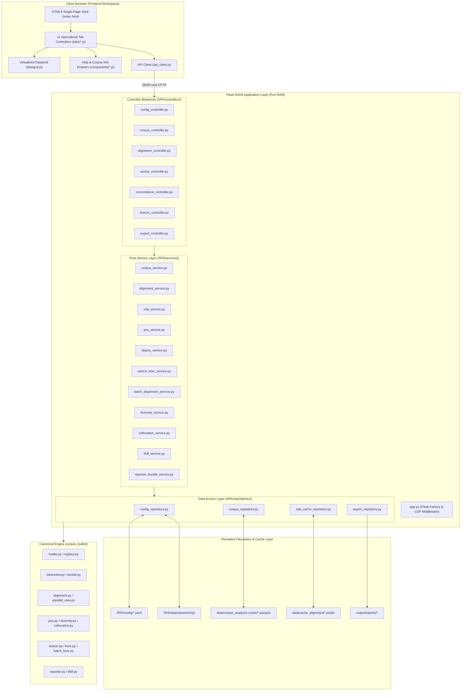
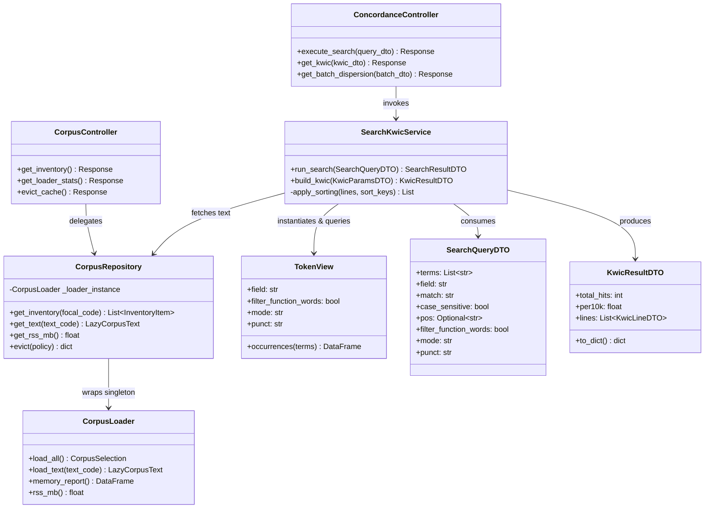
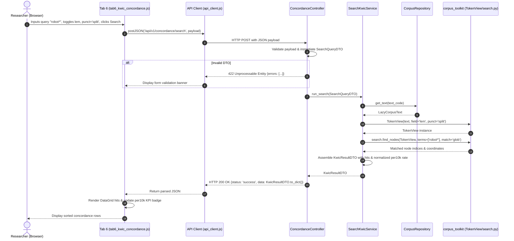
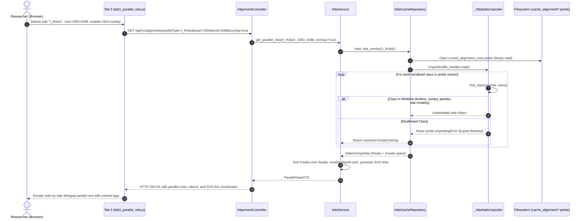

# 04 · Software Design Document (SDD) & System Architecture

## 1. Executive Summary & Architectural Invariants

This Software Design Document (SDD) governs the system design, directory structure, dataflow contracts, and modular decomposition of the **Corpus Analysis Single-Page Application (SPA)** located in [`scripts/corpus_analysis/SPA/`](file:///home/ben/Documents/thesis/scripts/corpus_analysis/SPA/).

The architecture enforces five inviolable system invariants:
1. **Decoupled 4-Tier Backend Architecture**: Strict stratification across `Controllers -> Services -> Repositories -> Models/DTOs`.
   - **Controllers** handle HTTP serialization, query parsing, parameter validation, and status code dispatching.
   - **Services** encapsulate pure computational orchestration and business logic. Services must perform **zero** direct disk or database I/O.
   - **Repositories** exclusively govern data access, caching (`Parquet`, `Pickle`), file storage, and integration with the underlying canonical engine ([`corpus_toolkit/`](file:///home/ben/Documents/thesis/scripts/corpus_analysis/corpus_toolkit/)).
   - **Models/DTOs** provide typed, immutable data transfer schemas between layers.
2. **Re-use of Canonical Analytical Engine**: Zero algorithm re-implementation. All statistical, tokenization, lemmatization, and alignment calculations execute by orchestrating the 31 production-grade modules in [`corpus_toolkit/`](file:///home/ben/Documents/thesis/scripts/corpus_analysis/corpus_toolkit/).
3. **Hard Modular Line-Count Budget**: Every module across the Python backend adheres to a pre-formatting target of $\le 180$ lines and a strict automated CI hard gate of $\le 200$ physical lines.
4. **Memory Ceiling & Resource Invariant**: The application process strictly enforces a resident set size (RSS) ceiling of $< 1{,}500\text{ MB}$ through content-addressed Parquet caching, streaming iteration, and explicit eviction policies.
5. **Security & Sandboxing Invariants**: Absolute containment via custom unpickling whitelists (`_NdaSafeUnpickler`), regular expression timeout guards against catastrophic backtracking (ReDoS), and strict local Content Security Policies (CSP).

---

## 2. Layer Responsibilities & System Boundaries

```
+---------------------------------------------------------------------------------------+
|                                    Frontend (UI)                                      |
|   HTML5 Shell + 11-Tab Dashboard + Virtualized DataGrid + Vanilla ES6 Components      |
+---------------------------------------------------------------------------------------+
                                           |
                                           | REST JSON / Form Data (/api/v1/...)
                                           v
+---------------------------------------------------------------------------------------+
|                            Flask WSGI Controller Layer                                |
|   SPA/controllers/ (config, corpus, alignment, syntax, concordance, lexicon, export)  |
|   - HTTP Request Parsing & DTO Instantiation                                          |
|   - Status Code Mapping (200, 400, 404, 422, 500)                                     |
+---------------------------------------------------------------------------------------+
                                           |
                                           | Typed DTOs / Method Parameters
                                           v
+---------------------------------------------------------------------------------------+
|                                Service Orchestration Layer                            |
|   SPA/services/ (corpus, pos, depviz, kwic, dispersion, diversity, collocation, etc.)  |
|   - Pure Analytical Workflow Orchestration                                            |
|   - Zero Direct File I/O (Stateless)                                                  |
+---------------------------------------------------------------------------------------+
                                           |
                                           | Domain Entity Requests / Storage Keys
                                           v
+---------------------------------------------------------------------------------------+
|                              Repository & Data Access Layer                           |
|   SPA/repositories/ (config_repo, corpus_repo, nda_cache_repo, export_repo)           |
|   - Filesystem I/O, YAML Parsing, Content-Addressed Caching (Parquet)                 |
|   - Safe Pickle Deserialization (_NdaSafeUnpickler)                                   |
+---------------------------------------------------------------------------------------+
                                           |
                                           | Engine API Calls & In-Memory Ensembles
                                           v
+---------------------------------------------------------------------------------------+
|                             Canonical Engine (corpus_toolkit/)                        |
|   config, loader, tokenview, alignment, pos, depviz, search, kwic, diversity, etc.    |
+---------------------------------------------------------------------------------------+
```

### 2.1 Presentation & View Layer (`SPA/views/` and `SPA/static/`)
- **HTML5 Application Shell**: Single-page container hosting the Global Control Header, Tab Navigation Bar, 11 Workspace Workstations, Status Footer, and two Slide-Over Drawers (Help/Formula Drawer and Corpus Info / Settings Drawer).
- **Presentation Logic (`SPA/static/js/`)**: Modular Vanilla ES6 classes (e.g., `DataGridComponent`, `KwicViewer`, `GraphCollScatter`, `DisplacyCanvas`). Zero heavy framework dependencies (no React/Vue/Angular); zero external CDN dependencies.
- **Rendering & Visualization**: Plotly.js (bundled offline) for statistical scatter, radar, and barcode charts; SVG DOM engines for stepped bilingual alignment connectors and `displaCy` dependency arcs.

### 2.2 Controller Layer (`SPA/controllers/`)
- Registers Flask Blueprints with the prefix `/api/v1/`.
- Validates request payloads against DTO schema definitions (`SPA/models/`).
- Translates validation errors into standard HTTP `400 Bad Request` or `422 Unprocessable Entity` JSON responses.
- Catches domain-level exceptions and routes them to standard error handlers (`SPA/controllers/error_handlers.py`).

### 2.3 Service Layer (`SPA/services/`)
- Implements stateless business workflows.
- Transforms raw repository objects (e.g., `LazyCorpusText`, `AlignmentIndex`) into analytical result representations.
- Enforces computational invariants (e.g., sample size thresholds for bootstrap resamples, chunking limits for dispersion, union-slot contingency bounds).
- **Rule**: No service module may import `open()`, `pathlib.Path`, `os.walk()`, `pickle`, or `yaml`.

### 2.4 Repository Layer (`SPA/repositories/`)
- Acts as the single boundary between the filesystem and the application.
- Houses `ConfigRepository` to load and mutate `SPA/config/spa_paths.yaml` and `SPA/config/corpus_metadata.yaml`.
- Houses `CorpusRepository` to manage `CorpusLoader`, track process RSS, and invoke `cache.py` routines.
- Houses `NdaCacheRepository` to deserialize NDA pickling data using the restricted `_NdaSafeUnpickler` subclass.
- Houses `ExportRepository` to generate atomic research bundles (`.md`, `.tsv`, `.png`, `.xlsx`) in the configured output directory.

### 2.5 Models & DTOs Layer (`SPA/models/`)
- Defines Python `@dataclass` structures for incoming parameters and outgoing JSON payloads.
- Includes explicit serialization methods (`to_dict()`, `from_dict()`).
- Encapsulates domain value objects (e.g., `TokenCoordinates`, `AlignmentRow`, `KwicLine`, `DiversityRow`).

---

## 3. Physical Directory Structure & Component Allocation

```
scripts/corpus_analysis/SPA/
|-- app.py                             # WSGI Entrypoint & Flask Factory (<= 150 lines)
|-- config/
|   |-- spa_paths.yaml                 # User-configurable path registry
|   +-- corpus_metadata.yaml           # Source catalog, book metadata, image maps
|-- controllers/                       # Flask Blueprints (HTTP mapping & validation)
|   |-- __init__.py
|   |-- config_controller.py           # Paths, metadata, image uploads
|   |-- corpus_controller.py           # Inventory, loaders, memory, schemas
|   |-- alignment_controller.py        # Alignments, length deltas, NDA parallel
|   |-- syntax_controller.py           # POS distributions, displaCy trees
|   |-- concordance_controller.py      # Search engine, 5-view KWIC, batch Juilland
|   |-- lexicon_controller.py          # 22 diversity metrics, union-slot collocations
|   |-- export_controller.py           # Sublinear TF-IDF, report bundles, ZIPs
|   +-- error_handlers.py              # 400, 404, 422, 500 JSON exception handlers
|-- services/                          # Pure analytical orchestration (Zero File I/O)
|   |-- __init__.py
|   |-- corpus_service.py              # Loader orchestration & memory summaries
|   |-- alignment_service.py           # R_sent, length deltas, bipartite mapping
|   |-- nda_service.py                 # Irrealia vs Realia sorting, link generation
|   |-- pos_service.py                 # UPOS profiling, delta-pp, bootstrap CIs
|   |-- depviz_service.py              # CoNLL parser, displaCy SVG arc payload
|   |-- search_kwic_service.py         # Node querying, 5-view KWIC sorting
|   |-- batch_dispersion_service.py    # 10-chunk Juilland D, Benjamini-Hochberg FDR
|   |-- diversity_service.py           # 22 LancsBox-X metrics, MATTR, MTLD, HD-D
|   |-- collocation_service.py         # Union-slot 2x2 contingency, GraphColl
|   |-- tfidf_service.py               # Sublinear TF + smooth IDF + L2 norm
|   +-- reporter_bundle_service.py     # Research report orchestration
|-- repositories/                      # Exclusive data access, cache & filesystem I/O
|   |-- __init__.py
|   |-- config_repository.py           # YAML reading/writing, asset paths
|   |-- corpus_repository.py           # CorpusLoader, Parquet cache, RSS monitor
|   |-- nda_cache_repository.py        # Safe unpickling of NDA caches
|   +-- export_repository.py           # Atomic bundle creation & ZIP archiving
|-- models/                            # DTOs, Dataclasses & Value Objects
|   |-- __init__.py
|   |-- config_dto.py                  # PathConfigDTO, MetadataDTO, AssetDTO
|   |-- corpus_dto.py                  # InventoryItemDTO, MemoryReportDTO
|   |-- alignment_dto.py               # AlignmentCardDTO, NdaRowDTO, LinkDTO
|   |-- syntax_dto.py                  # PosProfileDTO, DisplacyArcDTO
|   |-- search_dto.py                  # SearchQueryDTO, KwicResultDTO
|   |-- lexicon_dto.py                 # DiversityMetricsDTO, CollocationDTO
|   +-- report_dto.py                  # ExportBundleDTO, ReportSectionDTO
|-- views/                             # HTML5 Templates
|   +-- index.html                     # Unified single-page workstation shell
+-- static/                            # Client-side assets (Zero external CDNs)
    |-- css/
    |   |-- spa_base.css               # Core CSS variables, typography, reset
    |   |-- spa_layout.css             # 11-tab grid, headers, footers, splitters
    |   |-- spa_components.css         # DataGrid, modals, badges, drawers
    |   +-- spa_viz.css                # DisplaCy trees, SVG lines, Plotly overrides
    |-- js/
    |   |-- app.js                     # Global event bus & workstation controller
    |   |-- api_client.js              # Fetch client with timeout & error handling
    |   |-- datagrid.js                # 20-row virtualized table component
    |   |-- tabs/                      # Tab-specific workstation view controllers
    |   |   |-- tab1_inventory.js
    |   |   |-- tab2_alignment.js
    |   |   |-- tab3_parallel_nda.js
    |   |   |-- tab4_pos_profiler.js
    |   |   |-- tab5_depviz_studio.js
    |   |   |-- tab6_kwic_concordance.js
    |   |   |-- tab7_batch_dispersion.js
    |   |   |-- tab8_lexical_diversity.js
    |   |   |-- tab9_collocations.js
    |   |   |-- tab10_tfidf_reporter.js
    |   |   +-- tab11_corpus_explorer.js
    |   +-- components/                # Reusable UI widgets
    |       |-- help_docs_drawer.js    # Operational help & mathematical formulas
    |       |-- corpus_info_modal.js   # Book covers, author cards & metadata
    |       |-- settings_modal.js      # Interactive path & cache configuration
    |       +-- svg_connector.js       # Stepped SVG link lines
    +-- assets/
        |-- img/                       # Book covers & author portrait images
        +-- vendor/                    # Localized third-party libraries (Plotly.js)
```

---

## 4. Module Line-Count Budget Table

To preserve code maintainability and prevent monolithic script degradation, every Python module adheres to strict size constraints:

| Layer / Directory | Module Name | Primary Responsibility | Target LOC | Hard Gate LOC |
|---|---|---|---|---|
| **Root** | `app.py` | Flask factory, CORS/CSP middleware, Blueprint registry | 130 | 180 |
| **Controllers** | `config_controller.py` | Endpoints for paths, metadata, image uploads | 140 | 180 |
| | `corpus_controller.py` | Endpoints for inventory, loader stats, cache eviction | 150 | 190 |
| | `alignment_controller.py` | Endpoints for cardinality, length deltas, NDA parallel | 160 | 195 |
| | `syntax_controller.py` | Endpoints for UPOS comparative profiles, displaCy trees | 145 | 185 |
| | `concordance_controller.py` | Endpoints for search query, 5-view KWIC, batch dispersion | 165 | 200 |
| | `lexicon_controller.py` | Endpoints for 22 diversity metrics, collocations | 160 | 195 |
| | `export_controller.py` | Endpoints for TF-IDF keyness, report bundles, ZIPs | 140 | 180 |
| | `error_handlers.py` | HTTP error interceptors & JSON envelopes | 80 | 120 |
| **Services** | `corpus_service.py` | Loader scope aggregation, memory report generation | 140 | 180 |
| | `alignment_service.py` | Cardinality distribution, delta calculations, ratio stats | 150 | 190 |
| | `nda_service.py` | Disjoint set filtering, Irrealia-over-Realia precedence | 160 | 195 |
| | `pos_service.py` | UPOS percentages, delta-pp, percentile bootstrap CIs | 165 | 200 |
| | `depviz_service.py` | CoNLL parsing, ClearNLP-to-UD mapping, displaCy SVG | 155 | 190 |
| | `search_kwic_service.py` | Query execution, multi-key stable sorting, span clamping | 165 | 200 |
| | `batch_dispersion_service.py` | 10-chunk rates, Juilland's $D$, Benjamini-Hochberg FDR | 150 | 190 |
| | `diversity_service.py` | 22 LancsBox-X formulas, sliding MATTR, MTLD, HD-D | 170 | 200 |
| | `collocation_service.py` | Union-slot 2x2 contingency tables, 6 association scores | 165 | 200 |
| | `tfidf_service.py` | Sublinear TF, smooth IDF, L2 norm, chunk pseudo-docs | 145 | 185 |
| | `reporter_bundle_service.py` | Bundling dataframes, plots, markdown into export sets | 140 | 180 |
| **Repositories** | `config_repository.py` | YAML reading/writing, path resolution, image asset I/O | 135 | 175 |
| | `corpus_repository.py` | Singleton CorpusLoader wrapper, Parquet cache, RSS MB | 150 | 190 |
| | `nda_cache_repository.py` | Restricted `_NdaSafeUnpickler`, pickle stream isolation | 125 | 165 |
| | `export_repository.py` | Atomic disk writes (.md, .tsv, .png, .xlsx) and zip archive | 130 | 170 |
| **Models** | `config_dto.py` | Data transfer objects for paths, books, authors | 110 | 150 |
| | `corpus_dto.py` | Data transfer objects for inventory, memory, schemas | 120 | 160 |
| | `alignment_dto.py` | Data transfer objects for alignment cards, NDA spans | 135 | 175 |
| | `syntax_dto.py` | Data transfer objects for POS metrics, dependency tokens | 125 | 165 |
| | `search_dto.py` | Data transfer objects for search queries, KWIC lines | 140 | 180 |
| | `lexicon_dto.py` | Data transfer objects for diversity rows, collocations | 130 | 170 |
| | `report_dto.py` | Data transfer objects for report configurations, bundles | 105 | 145 |

---

## 5. Architectural Diagrams

### 5.1 Component Architecture & Dataflow



### 5.2 Domain Class Diagram (MVC + Service + Repository Pattern)



### 5.3 Sequence Diagram: End-to-End Concordance Search Flow



### 5.4 Sequence Diagram: Safe NDA Cache Deserialization Flow



---

## 6. State Management, Memory Invariants & Concurrency

### 6.1 Process Resident Set Size (RSS) Budget
- The backend process operates under an absolute ceiling of $< 1{,}500\text{ MB}$ RSS.
- The `CorpusRepository` measures memory footprint via `/proc/self/statm` on Linux (`loader.rss_mb()`).
- When physical memory usage exceeds $1{,}200\text{ MB}$, the repository automatically triggers `.evict_all()` on the underlying `CorpusLoader` before servicing new analytical queries.
- Heavy transformations (such as computing LancsBox-X metrics across all 13 texts or scanning 22-column diversity profiles) must utilize `.iter_evicting()` generators to stream texts sequentially into memory and discard their tokens immediately after metrics are accumulated.

### 6.2 Concurrency & WSGI Configuration
- The application executes on **Flask WSGI** served via **Gunicorn** or **Waitress**:
  - `workers = 1`: Due to the shared in-memory singleton of `CorpusLoader` and Parquet caching structures, multi-process workers would multiply the memory footprint.
  - `threads = 4`: Threaded execution allows concurrent servicing of lightweight metadata, status, and config requests while an analytical computation executes.
  - Computationally intensive endpoints (e.g., bootstrap resamples or batch dispersion) release the Python GIL during NumPy/SciPy vectorized operations.

---

## 7. Acceptance Gate Checklist

- [ ] All 5 architectural tiers (`UI -> Controllers -> Services -> Repositories -> corpus_toolkit`) defined with strict boundary separation.
- [ ] Rule verified: Zero file I/O operations (`open`, `Path`, `pickle`, `yaml`) in `SPA/services/`.
- [ ] Complete module line-budget table documented with target $\le 180$ LOC and hard CI gate $\le 200$ LOC.
- [ ] 4 formal Mermaid diagrams (Component, Class, Sequence, Safe Unpickling) fully specified with valid syntax.
- [ ] Process memory ceiling of $< 1{,}500\text{ MB}$ RSS and streaming eviction mechanisms formally specified.
- [ ] Whitelisted unpickling security invariant (`_NdaSafeUnpickler`) integrated into repository specs.
