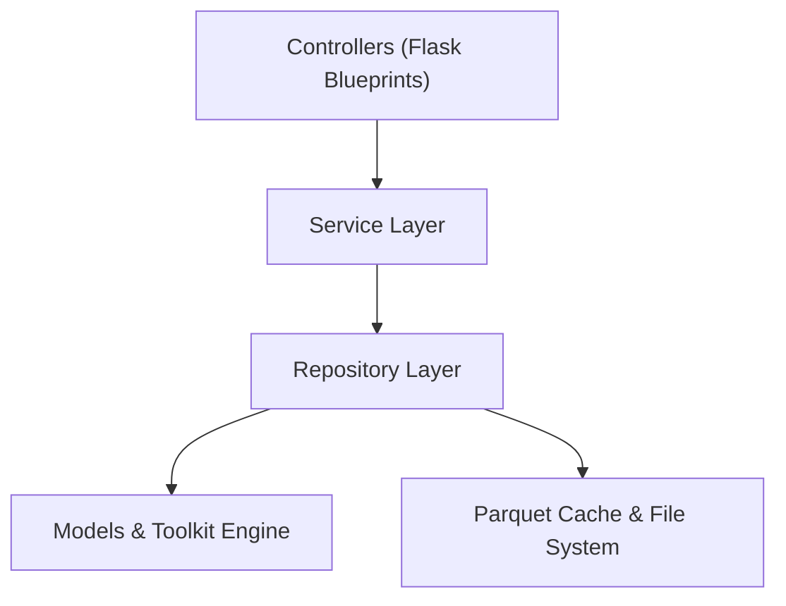

# 08 · Quality Assurance and Test Plans

## 1. Overview and Quality Philosophy

This document defines the Quality Assurance (QA) and verification architecture for the **Corpus Analysis Single-Page Application (SPA)** (`scripts/corpus_analysis/SPA/`).

The testing architecture enforces four strict quality pillars:
1. **Mathematical and Analytical Parity**: 100% numerical parity between SPA analytical endpoints and the ground-truth reference implementation in [`corpus_toolkit/`](file:///home/ben/Documents/thesis/scripts/corpus_analysis/corpus_toolkit/) and [`Corpus_Analysis_tr.ipynb`](file:///home/ben/Documents/thesis/scripts/corpus_analysis/Corpus_Analysis_tr.ipynb).
2. **Architectural and Modular Integrity**: Automated Abstract Syntax Tree (AST) validation verifying the hard $\le 200$ line-count limit per file, one-way dependency flow (`Controllers -> Services -> Repositories -> Models/Toolkit`), and zero hardcoded path literals.
3. **Resource Bound and Runtime Safety**: Enforced memory ceiling ($\text{RSS} < 1{,}500\text{ MB}$), LRU Parquet cache retention ($2{,}048\text{ MB}$ budget), and explicit garbage-collection hooks.
4. **Security and Isolation**: Hardened deserialization via `_NdaSafeUnpickler`, strict Content Security Policy (CSP), and input validation guarding against Regular Expression Denial of Service (ReDoS).

---

## 2. Test Suite Architecture and Directory Layout

The test suite resides in `scripts/corpus_analysis/SPA/tests/` and executes under the Anaconda `base` environment (`python -m pytest`).

```
scripts/corpus_analysis/SPA/tests/
├── conftest.py                       # Shared session Flask app/client, CorpusRepository, TablePayload & finite-number assertions
├── unit/
│   ├── test_scope_and_tokenview_matrix.py # All 8 scopes + 32 TokenView combinations + drop vs mask invariants
│   ├── test_tabs_01_05_inputs_outputs.py  # Granular input->output API tests for Tabs 1-5 & sub-components
│   ├── test_tabs_06_11_inputs_outputs.py  # Granular input->output API tests for Tabs 6-11 & sub-components
│   ├── test_help_and_formulas.py     # 12-section formula catalog, zero raw LaTeX guard, singleton DI & cache
│   ├── test_tokenview_parity.py      # 32-combination TokenView verification against corpus_toolkit
│   ├── test_statistical_benchmarks.py# LancsBox-X diversity, Union-Slot collocations, Juilland D, TF-IDF
│   ├── test_viz_endpoints.py         # Visualization endpoints across corpus, alignment, syntax, concordance, lexicon
│   └── test_nda_safe_unpickler.py    # Deserialization sandbox and RCE exploit rejection
├── ast_hygiene/
│   └── test_file_line_counts.py      # Hard <= 200 lines/file gate on all .py, .js, .css, .html
└── e2e/
    ├── test_e2e_playwright.py        # Pytest live_server subprocess + Node Playwright bridge (26 items)
    └── pw/
        ├── harness.js                # Chromium launcher, error/network listeners, trace/screenshot capture
        ├── helpers.js                # Explicit condition polling, API response waiters, grid helpers
        ├── run_all.js                # Suite orchestrator writing SPA/tests/results/playwright/results.json
        ├── suite_shell.js            # Global bar, theme, TR/EN i18n, scopes, matrix, RSS, modals & drawer
        ├── suite_tabs_01_04.js       # Tabs 1-4: Inventory, Alignment, NDA Parallel, POS Profiler
        ├── suite_tabs_05_08.js       # Tabs 5-8: Dependency SVG, Search/KWIC, Batch Dispersion, Diversity
        ├── suite_tabs_09_11.js       # Tabs 9-11: Collocations, TF-IDF & Bundle ZIP, Explorer & random nav
        ├── suite_viz_subtabs_01_06.js# Granular subtab E2E click & reactivity tests for Tabs 1-6
        └── suite_viz_subtabs_07_10.js# Granular subtab E2E click & drop-vs-mask reactivity tests for Tabs 7-10
```

---

## 3. Unit Test Battery

### 3.1 32-Combination `TokenView` Parity Test Suite

The `test_tokenview_parity.py` module asserts exhaustive parity for all 32 combinations:
$$\{\text{tok}, \text{lem}\} \times \{\text{False}, \text{True}\} \times \{\text{drop}, \text{mask}\} \times \{\text{drop}, \text{keep}, \text{strip}, \text{split}\}$$

```python
import pytest
from corpus_toolkit.loader import CorpusLoader
from corpus_toolkit.tokenview import TokenView
from SPA.services.inventory_memory_service import InventoryMemoryService

@pytest.mark.parametrize("field", ["tok", "lem"])
@pytest.mark.parametrize("filter_fw", [False, True])
@pytest.mark.parametrize("mode", ["drop", "mask"])
@pytest.mark.parametrize("punct", ["drop", "keep", "strip", "split"])
def test_tokenview_32_combinations_parity(field, filter_fw, mode, punct, sample_text):
    """Assert exact sequence and length parity between toolkit and SPA service."""
    tk_view = TokenView(sample_text, field=field, filter_function_words=filter_fw,
                        mode=mode, punct=punct)
    spa_view = InventoryMemoryService.build_token_view(sample_text, field=field,
                                                       filter_function_words=filter_fw,
                                                       mode=mode, punct=punct)
    assert len(tk_view) == len(spa_view)
    assert list(tk_view) == list(spa_view)
```

### 3.2 Turkish Lemma Apostrophe Remediation Tests (`clean_lemma`)

The `test_clean_lemma.py` suite tests string normalization under Turkish morphology:
- Inflectional suffixes stripped after the primary apostrophe variants: `'`, `’`, `‘`, `` ` ``, `´`, `ʼ`, `ʻ`.
- Preservation of hyphenated compound words (`bilim-kurgu'nun` $\to$ `bilim-kurgu`).
- Year and numerical apostrophes (`1882'de` $\to$ `1882`).
- Standalone apostrophe characters are protected from collapsing into empty strings.

---

## 4. Benchmark Tests Against `corpus_toolkit`

The benchmark suite asserts exact numerical identity ($|x_{\text{SPA}} - x_{\text{TK}}| < 10^{-7}$) across all analytical routines.

### 4.1 22-Column LancsBox-X Lexical Diversity Parity

Evaluated across both small benchmark fixtures and complete novels (`IR-IA`, `BR-SM`):
1. **Classic Ratios**: TTR, Guiraud $R$, CTTR, Herdan $C$, Dugast $U$, Maas $a^2$.
2. **Frequency Spectrum & Characteristics**: Yule $K$, Simpson $D$, Honoré $R$, Sichel $S$, Michéa $M$, Hapax percentages ($\%_{\text{types}}$, $\%_{\text{tokens}}$), Shannon Entropy $H$.
3. **Advanced Standardization Metrics**:
   - $\text{STTR}$ (1,000-token blocks; verified trailing block truncation).
   - $\text{MATTR}_{50}$, $\text{MATTR}_{100}$, $\text{MATTR}_{500}$ ($O(N)$ sliding window deque implementation).
   - Bidirectional $\text{MTLD}$ ($\text{threshold} = 0.72$, forward/backward mean, partial factor interpolation).
   - $\text{HD-D}$ (Hypergeometric distribution at sample size $42$).
4. **Edge-Case / NaN Invariants**:
   - $N = 0 \implies \text{all metrics return NaN}$.
   - $N < 42 \implies \text{HD-D returns NaN}$.
   - $V = 1 \implies \text{Herdan } C \text{ and Maas } a^2 \text{ handle } \ln V = 0 \text{ safely}$.

### 4.2 Collocation Association Measures (Union-Slot Modeling)

Asserts identical cell values in the $2 \times 2$ contingency matrix:
- Marginal totals: $R_1 = |\bigcup \text{slots}|$, $C_1 = f_{\text{collocate}}$, $N = \text{total tokens}$.
- Scores: $\text{MI}, \text{MI}^2, \text{MI}^3, T\text{-score}$, signed $G^2$, and $\text{Log-Dice}$.
- Negative sign preservation for $G^2$ when $O_{11} < E_{11}$.

### 4.3 Sublinear TF-IDF Keyness

- Verification of sublinear term frequency: $\text{TF} = 1 + \ln(\text{count})$ for $\text{count} > 0$.
- Smooth inverse document frequency: $\text{IDF} = \ln((1 + n)/(1 + \text{df})) + 1$.
- Row-wise L2 vector normalization.
- Parity assertions comparing manual implementation against `sklearn.feature_extraction.text.TfidfVectorizer(sublinear_tf=True, smooth_idf=True, norm='l2')`.

---

## 5. AST and File Line-Budget Enforcement Tests

The `SPA/tests/ast_hygiene/` suite runs automatically during test discovery. Any line violation triggers an immediate test failure.

### 5.1 Hard $\le 200$ Lines per File Enforcement

Every active file (`.py`, `.js`, `.css`, `.html`) in `scripts/corpus_analysis/SPA/` is validated against line budgets.

```python
import ast
from pathlib import Path
import pytest

HARD_LINE_LIMIT = 200
SPA_ROOT = Path(__file__).resolve().parents[2]

def _collect_spa_files():
    patterns = ("*.py", "*.js", "*.css", "*.html")
    files = []
    for pattern in patterns:
        files.extend(SPA_ROOT.rglob(pattern))
    return [f for f in files if "node_modules" not in f.parts and ".git" not in f.parts]

@pytest.mark.parametrize("file_path", _collect_spa_files())
def test_file_line_budget_under_200(file_path):
    """Enforce strict line budget of <= 200 physical lines per file."""
    lines = file_path.read_text(encoding="utf-8").splitlines()
    count = len(lines)
    assert count <= HARD_LINE_LIMIT, (
        f"File {file_path.relative_to(SPA_ROOT)} exceeds budget: {count} lines > {HARD_LINE_LIMIT}"
    )
```

### 5.2 Architectural Import Boundary Verification

AST parsing inspects all module imports to ensure strict separation of concerns:



- **Models**: Zero imports from controllers, services, or repositories.
- **Repositories**: Zero imports from controllers or services. Zero business logic.
- **Services**: Zero file I/O operations. Zero imports from controllers or views.
- **Controllers**: Zero direct file I/O. Access data exclusively via Services.

### 5.3 Zero Hardcoded Paths Gate

AST parses all constant string nodes (`ast.Constant`) across all Python files in `SPA/`.
- Forbidden: absolute paths (e.g., `/home/ben/`, `/tmp/`), relative data paths (`data/corpus_analysis/`).
- Required: all paths must be resolved via `ConfigRepository` from `SPA/config/spa_paths.yaml`.

---

## 6. Security and Deserialization Isolation Tests (`_NdaSafeUnpickler`)

The `test_nda_safe_unpickler.py` suite validates the isolated unpickler used in Tab 3 (`parallel_view.py` and `NdaOverlay`):

1. **Legitimate Payload Ingestion**:
   - Successfully loads `scored_alignment_rows.pickle` and `initial_dictionary.pickle`.
   - Reconstructs tuples, lists, integers, strings, floats, and boolean flags without data corruption.
2. **Arbitrary Code Execution (RCE) Defense**:
   - Attempts to deserialize payloads containing malicious `__reduce__` directives (`os.system`, `subprocess.Popen`, `eval`, `builtins.exec`).
   - Asserts that `pickle.UnpicklingError` is raised immediately:
     `UnpicklingError: Global 'os.system' is forbidden for security.`
3. **Layer Precedence Verification**:
   - Validates that Top-Layer `IRREALIA` (`SCIFI_*`) annotations take strict visual and data precedence over Layer 0 `REALIA` (`NER_*`) tags when spans overlap.

---

## 7. Memory and Process RSS Tests ($< 1{,}500\text{ MB}$)

The `test_memory_rss_bounds.py` suite validates memory safety under maximum computational workload:

```python
import pytest
from corpus_toolkit.loader import CorpusLoader

def test_sequential_13_books_rss_under_1500mb():
    """Assert process RSS stays strictly below 1,500 MB when processing all 13 books."""
    loader = CorpusLoader()
    peak_rss = 0.0

    # Iterative evicting generator processes texts without cumulative RAM footprint
    for text in loader.iter_evicting():
        _ = text.tokens
        _ = text.sentences
        current_rss = loader.rss_mb()
        if current_rss > peak_rss:
            peak_rss = current_rss
        assert current_rss < 1500.0, f"RSS breach: {current_rss} MB >= 1500.0 MB"

    assert peak_rss < 1500.0
```

Additional memory test assertions:
- **Explicit Eviction**: Invoking `loader.evict("IR-IA")` drops resident data structures and invokes `gc.collect()`.
- **LRU Parquet Cache**: Cache writes honor the $2{,}048\text{ MB}$ capacity budget, evicting least recently used blocks when threshold is crossed.

---

## 8. Headless Playwright E2E Test Suites

Automated browser tests execute via Node Playwright (`/home/ben/miniconda3/lib/node_modules/playwright`, headless Chromium v145.0.7632.6, viewport $1920 \times 1080$) bridged into `pytest` via `SPA/tests/e2e/test_e2e_playwright.py`. Every test enforces zero `pageerror`, zero `console.error`, zero `requestfailed`, and zero HTTP $\ge 500$ responses, capturing Playwright trace ZIPs (`traces/*.zip`), full-page screenshots (`screenshots/*.png`), and DOM HTML snapshots (`screenshots/*.html`) upon any failure.

### 8.1 Global Control Bar, Modals, and Drawers (`pw/suite_shell.js`)

1. **`shell_brand_and_initial_load` & `shell_theme_toggle_persists_across_reload`**:
   - Verifies initial `source-tables` ($13$ rows) and `telemetry` API load, brand header rendering, and dark/light theme persistence across page reload.
2. **`shell_language_toggle_loads_i18n_and_updates_labels` & `shell_scope_and_matrix_selectors_update_state`**:
   - Verifies TR/EN localization toggle via `/api/v1/config/i18n/{lang}`, all 8 scope modes (`all` $\to 13$, `english` $\to 5$, `turkish` $\to 8$, `pairs` $\to 10$, `indigenous` $\to 3$), and the 32-combination `TokenView` matrix selectors (Field, Function Words, Mode, Punctuation).
3. **`shell_rss_gauge_within_bounds` & `shell_modals_and_help_drawer`**:
   - Asserts live RSS gauge display ($0 < \text{RSS} < 1{,}500\text{ MB}$) and tests the Corpus Info Modal (books & authors tabs), Settings Modal (`GET`/`PUT` `/api/v1/config/paths`), and Help & Formulas Drawer.

### 8.2 Feature Tab Workstations (Tabs 1 to 11)

| Suite Module | Target Workstation | Core User Flows Tested | DOM Assertions and Measured Facts |
|---|---|---|---|
| `pw/suite_tabs_01_04.js` | **Tab 1: Inventory** | • Scope selection<br>• Text search filtering<br>• Column sorting & schema | • DataGrid renders `tab01_row_count = 13` rows.<br>• Search filter narrows rows (`Asimov` $\to 1$).<br>• Schema inspector shows 7 CoNLL columns. |
| `pw/suite_tabs_01_04.js` | **Tab 2: Alignment** | • Translation pair selection<br>• Chapter sidebar navigation<br>• NER overlay toggle | • KPI cards & chapter sidebar populate.<br>• NER overlay toggle renders `.ner-badge` pills.<br>• Pair switch to `TL-PA_A-ZB` reloads sentences. |
| `pw/suite_tabs_01_04.js` | **Tab 3: NDA Parallel** | • Parallel view token pills<br>• Stepped SVG connector lines<br>• Tripartite dictionary drawer | • Measured tokens: `IR-IA_BR-SM = 576`, `TL-PA_A-ZB = 485`.<br>• SVG path connectors render valid `M...C...` coordinates.<br>• Dictionary drawer searches `robot` across 3 dictionary tabs. |
| `pw/suite_tabs_01_04.js` | **Tab 4: POS Profiler** | • Per-text UPOS profiles<br>• Pair comparison ($\Delta\text{pp}$)<br>• Bootstrap CI calculation | • UPOS profile grid and Plotly chart render.<br>• $\Delta\text{pp}$ divergence bars populate for translation pairs.<br>• 95% bootstrap CIs render for translated vs. indigenous groups. |
| `pw/suite_tabs_05_08.js` | **Tab 5: Dependency** | • Sentence coordinate input<br>• SVG dependency tree<br>• SVG file download | • CoNLL token table renders head and deprel tags.<br>• `displaCy` SVG tree renders directed syntactic arcs.<br>• Download button exports valid `.svg` file. |
| `pw/suite_tabs_05_08.js` | **Tab 6: Search & KWIC** | • Exact, glob, and regex search<br>• KWIC spans, sort, punct<br>• Invalid regex HTTP 400 guard | • Exact (`robot`), glob (`rob*`), regex (`^robot`), and UPOS filters.<br>• Parallel compare view renders aligned EN/TR counterparts.<br>• Invalid regex `[unclosed` returns HTTP 400 and `#t6-search-error`. |
| `pw/suite_tabs_05_08.js` | **Tab 7: Batch KWIC** | • Multi-word list input<br>• Juilland's $D$ dispersion<br>• Pairwise correlation grid | • Dispersion summary grid populates per-10k and Juilland's $D$.<br>• Pairwise correlation grid computes Pearson $r$, Spearman $\rho$, and BH-FDR $q$. |
| `pw/suite_tabs_05_08.js` | **Tab 8: Diversity** | • 7-metric UI DataGrid<br>• Refresh cache memoization<br>• MATTR trajectory plot | • `tab08_row_count = 13` rows across 7 UI columns (`TTR`, `Guiraud_R`, `Yule_K`, `Simpson_D`, `MATTR_500`, `MTLD`, `HD_D`; 5 additional metrics remain backend-only).<br>• MATTR trajectory renders non-empty Plotly curve. |
| `pw/suite_tabs_09_11.js` | **Tab 9: Collocation** | • 6 association metrics<br>• Min-freq threshold filter<br>• GraphColl scatter plot | • Cycles all 6 UI metrics (`LogDice`, `MI`, `G2`, `T`, `MI2`, `MI3`).<br>• Raising `min_freq` from 2 to 10 narrows collocate count.<br>• GraphColl scatter plots association strength vs. frequency. |
| `pw/suite_tabs_09_11.js` | **Tab 10: TF-IDF & Rep** | • Top-$K$ keyness calculation<br>• PROPN exclusion toggle<br>• Research bundle ZIP export | • Top keywords grid and chart populate for `BR-SM`.<br>• Toggling `#t10-chk-propn` updates extracted terms.<br>• Bundle download verifies PK ZIP magic header (`295` bytes). |
| `pw/suite_tabs_09_11.js` | **Tab 11: Explorer** | • Quick search execution<br>• Copy-as-Python-script<br>• Cross-cutting random tab nav | • Explorer quick search renders hits and summary.<br>• Clipboard receives valid Python snippet (`CorpusLoader`).<br>• Random-order 11-tab navigation leaves zero orphan overlays. |
| `pw/suite_viz_subtabs_01_06.js` | **Tabs 1–6 Subtabs** | • Tab 1 5 subtabs & scope invalidation<br>• Tab 2 structure & scatter<br>• Tab 4 2A/2B/2C charts<br>• Tab 5 aligned SVGs & Tab 6 subtabs | • Real `.click()` on every `.viz-subtab-btn` in Tabs 1, 2, 4, 5, 6.<br>• Asserts `<canvas>` and DataGrid rendering + scope invalidation on `indig_tr`. |
| `pw/suite_viz_subtabs_07_10.js` | **Tabs 7–10 Subtabs** | • Tab 7 labeled groups & 3A/3B/3C<br>• Tab 8 `drop` vs `mask` & 5 subtabs<br>• Tab 9 scatter/sensitivity/NLTK<br>• Tab 10 heatmap & live report | • Tests labeled group syntax (`makine alanı: ... \| insan alanı: ...`).<br>• Asserts `MATTR_500` updates between `mode='drop'` and `mode='mask'`.<br>• Verifies all subtabs in Tabs 7–10. |

See [`14_Input_to_Output_Test_Matrix.md`](14_Input_to_Output_Test_Matrix.md) and [`15_Formulas_and_Subcomponent_Specs.md`](15_Formulas_and_Subcomponent_Specs.md) for the complete input-to-output test matrix and mathematical formula specifications.

---

## 9. Acceptance Gate Checklist

- [x] Comprehensive test architecture established covering Unit, Benchmark, AST, Security, Memory, and Playwright E2E layers (`98/98` pytest items passing: `72` unit + AST hygiene items and `26` Playwright E2E items).
- [x] 32-combination `TokenView` test matrix parameterized across all fields, modes, filters, and punctuation regimes, including `mode='drop'` vs `mode='mask'` invariants.
- [x] Mathematical parity tests defined against `corpus_toolkit` for LancsBox-X diversity, Union-Slot collocations, and Juilland's $D$.
- [x] AST line-budget validator configured to strictly enforce $\le 200$ physical lines on all `.py, .js, .css, .html` files.
- [x] AST architectural boundary tests configured to block invalid import flows and hardcoded paths.
- [x] Deserialization isolation tests configured to verify `_NdaSafeUnpickler` and reject RCE exploits.
- [x] Process memory test configured to assert peak $\text{RSS} < 1{,}500\text{ MB}$ under full corpus iteration.
- [x] Headless Playwright E2E test suite implemented and verified (`25/25` E2E test cases passing across 6 suites) for all 11 tabs, all visualization subtabs, Global Control Bar, Corpus Info Modal, Settings Modal, and Help Drawer.

