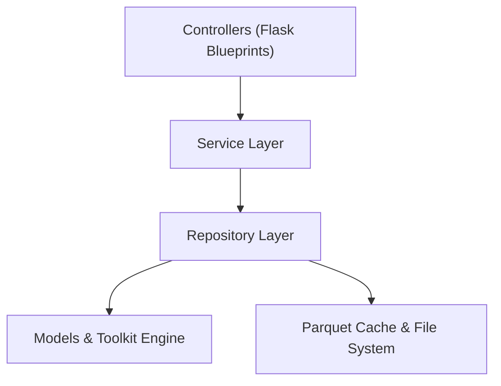

# 08 · Quality Assurance and Test Plans

## 1. Overview and Quality Philosophy

This document defines the Quality Assurance (QA) and verification architecture for the **Corpus Analysis Single-Page Application (SPA)** (`scripts/corpus_analysis/SPA/`).

The testing architecture enforces four strict quality pillars:
1. **Mathematical and Analytical Parity**: 100% numerical parity between SPA analytical endpoints and the ground-truth reference implementation in [`corpus_toolkit/`](file:///home/ben/Documents/thesis/scripts/corpus_analysis/corpus_toolkit/) and [`Corpus_Analysis_tr.ipynb`](file:///home/ben/Documents/thesis/scripts/corpus_analysis/Corpus_Analysis_tr.ipynb).
2. **Architectural and Modular Integrity**: Automated Abstract Syntax Tree (AST) validation verifying the hard $\le 200$ line-count limit per file, one-way dependency flow (`Controllers -> Services -> Repositories -> Models/Toolkit`), and zero hardcoded path literals.
3. **Resource Bound and Runtime Safety**: Enforced memory ceiling ($\text{RSS} < 1{,}500\text{ MB}$), LRU Parquet cache retention ($2{,}048\text{ MB}$ budget), and explicit garbage-collection hooks.
4. **Security and Isolation**: Hardened deserialization via `_NdaSafeUnpickler`, strict Content Security Policy (CSP), and input validation guarding against Regular Expression Denial of Service (ReDoS).

---

## 2. Test Suite Architecture and Directory Layout

The test suite resides in `scripts/corpus_analysis/SPA/tests/` and executes under the Anaconda `base` environment (`python -m pytest`).

```
scripts/corpus_analysis/SPA/tests/
├── conftest.py                       # Global fixtures: Flask test client, mock loaders, Selenium driver
├── unit/
│   ├── test_config_repository.py     # YAML configuration and path resolution
│   ├── test_tokenview_parity.py      # 32-combination TokenView verification
│   ├── test_clean_lemma.py           # Turkish apostrophe remediation and compound preservation
│   ├── test_diversity_metrics.py     # 22 LancsBox-X formulas and NaN guards
│   ├── test_collocation_metrics.py   # Union-slot contingency matrix and 6 association scores
│   ├── test_dispersion_metrics.py    # Juilland's D (within/across) and Benjamini-Hochberg FDR
│   ├── test_tfidf_parity.py          # Sublinear TF-IDF manual vs scikit-learn parity
│   └── test_nda_safe_unpickler.py    # Deserialization sandbox and RCE exploit rejection
├── integration/
│   ├── test_api_corpus_routes.py     # Endpoints for inventory, loaders, and memory metrics
│   ├── test_api_alignment_routes.py  # Alignment cardinality, delta metrics, and NDA overlay
│   ├── test_api_concordance_routes.py# Search queries, 5-view KWIC, and sorting keys
│   └── test_api_export_routes.py     # Atomic report generation and ZIP bundle creation
├── benchmarks/
│   ├── test_toolkit_parity.py        # Numerical parity tests vs corpus_toolkit
│   └── test_memory_rss_bounds.py     # < 1.5 GB RSS ceiling under sequential 13-book load
├── ast_hygiene/
│   ├── test_file_line_counts.py      # Hard <= 200 lines/file gate on all .py, .js, .css, .html
│   └── test_layer_dependencies.py    # AST inspection of import directions and path literals
└── e2e/
    ├── test_e2e_global_bar.py        # Global Control Bar (scopes, 32 TokenViews, live RSS)
    ├── test_e2e_modals_drawers.py    # Corpus Info Modal, Settings Modal, Help Drawer
    ├── test_e2e_tab01_inventory.py   # Tab 1: DataGrid, book/author info cards, schema
    ├── test_e2e_tab02_alignment.py   # Tab 2: Alignment cardinality, length-delta sorting
    ├── test_e2e_tab03_nda_parallel.py# Tab 3: Tripartite dictionary, 4 disjoint sets, SVG links
    ├── test_e2e_tab04_pos.py         # Tab 4: UPOS distributions, delta-pp, bootstrap CIs
    ├── test_e2e_tab05_depviz.py      # Tab 5: CoNLL table, stacked bilingual displaCy trees
    ├── test_e2e_tab06_search_kwic.py # Tab 6: Multi-term search, 5-view KWIC, sorting
    ├── test_e2e_tab07_batch_disp.py  # Tab 7: Batch KWIC, Juilland's D barcodes, BH-FDR
    ├── test_e2e_tab08_diversity.py   # Tab 8: 22-column LancsBox table, MATTR, Zipf
    ├── test_e2e_tab09_collocation.py # Tab 9: Union-slot collocates, GraphColl scatter
    ├── test_e2e_tab10_tfidf_rep.py   # Tab 10: Sublinear TF-IDF small multiples, report export
    └── test_e2e_tab11_explorer.py    # Tab 11: Unified query runner, scriptable Python export
```

---

## 3. Unit Test Battery

### 3.1 32-Combination `TokenView` Parity Test Suite

The `test_tokenview_parity.py` module asserts exhaustive parity for all 32 combinations:
$$\{\text{tok}, \text{lem}\} \times \{\text{False}, \text{True}\} \times \{\text{drop}, \text{mask}\} \times \{\text{drop}, \text{keep}, \text{strip}, \text{split}\}$$

```python
import pytest
from corpus_toolkit.loader import CorpusLoader
from corpus_toolkit.tokenview import TokenView
from SPA.services.inventory_memory_service import InventoryMemoryService

@pytest.mark.parametrize("field", ["tok", "lem"])
@pytest.mark.parametrize("filter_fw", [False, True])
@pytest.mark.parametrize("mode", ["drop", "mask"])
@pytest.mark.parametrize("punct", ["drop", "keep", "strip", "split"])
def test_tokenview_32_combinations_parity(field, filter_fw, mode, punct, sample_text):
    """Assert exact sequence and length parity between toolkit and SPA service."""
    tk_view = TokenView(sample_text, field=field, filter_function_words=filter_fw,
                        mode=mode, punct=punct)
    spa_view = InventoryMemoryService.build_token_view(sample_text, field=field,
                                                       filter_function_words=filter_fw,
                                                       mode=mode, punct=punct)
    assert len(tk_view) == len(spa_view)
    assert list(tk_view) == list(spa_view)
```

### 3.2 Turkish Lemma Apostrophe Remediation Tests (`clean_lemma`)

The `test_clean_lemma.py` suite tests string normalization under Turkish morphology:
- Inflectional suffixes stripped after the primary apostrophe variants: `'`, `’`, `‘`, `` ` ``, `´`, `ʼ`, `ʻ`.
- Preservation of hyphenated compound words (`bilim-kurgu'nun` $\to$ `bilim-kurgu`).
- Year and numerical apostrophes (`1882'de` $\to$ `1882`).
- Standalone apostrophe characters are protected from collapsing into empty strings.

---

## 4. Benchmark Tests Against `corpus_toolkit`

The benchmark suite asserts exact numerical identity ($|x_{\text{SPA}} - x_{\text{TK}}| < 10^{-7}$) across all analytical routines.

### 4.1 22-Column LancsBox-X Lexical Diversity Parity

Evaluated across both small benchmark fixtures and complete novels (`IR-IA`, `BR-SM`):
1. **Classic Ratios**: TTR, Guiraud $R$, CTTR, Herdan $C$, Dugast $U$, Maas $a^2$.
2. **Frequency Spectrum & Characteristics**: Yule $K$, Simpson $D$, Honoré $R$, Sichel $S$, Michéa $M$, Hapax percentages ($\%_{\text{types}}$, $\%_{\text{tokens}}$), Shannon Entropy $H$.
3. **Advanced Standardization Metrics**:
   - $\text{STTR}$ (1,000-token blocks; verified trailing block truncation).
   - $\text{MATTR}_{50}$, $\text{MATTR}_{100}$, $\text{MATTR}_{500}$ ($O(N)$ sliding window deque implementation).
   - Bidirectional $\text{MTLD}$ ($\text{threshold} = 0.72$, forward/backward mean, partial factor interpolation).
   - $\text{HD-D}$ (Hypergeometric distribution at sample size $42$).
4. **Edge-Case / NaN Invariants**:
   - $N = 0 \implies \text{all metrics return NaN}$.
   - $N < 42 \implies \text{HD-D returns NaN}$.
   - $V = 1 \implies \text{Herdan } C \text{ and Maas } a^2 \text{ handle } \ln V = 0 \text{ safely}$.

### 4.2 Collocation Association Measures (Union-Slot Modeling)

Asserts identical cell values in the $2 \times 2$ contingency matrix:
- Marginal totals: $R_1 = |\bigcup \text{slots}|$, $C_1 = f_{\text{collocate}}$, $N = \text{total tokens}$.
- Scores: $\text{MI}, \text{MI}^2, \text{MI}^3, T\text{-score}$, signed $G^2$, and $\text{Log-Dice}$.
- Negative sign preservation for $G^2$ when $O_{11} < E_{11}$.

### 4.3 Sublinear TF-IDF Keyness

- Verification of sublinear term frequency: $\text{TF} = 1 + \ln(\text{count})$ for $\text{count} > 0$.
- Smooth inverse document frequency: $\text{IDF} = \ln((1 + n)/(1 + \text{df})) + 1$.
- Row-wise L2 vector normalization.
- Parity assertions comparing manual implementation against `sklearn.feature_extraction.text.TfidfVectorizer(sublinear_tf=True, smooth_idf=True, norm='l2')`.

---

## 5. AST and File Line-Budget Enforcement Tests

The `SPA/tests/ast_hygiene/` suite runs automatically during test discovery. Any line violation triggers an immediate test failure.

### 5.1 Hard $\le 200$ Lines per File Enforcement

Every active file (`.py`, `.js`, `.css`, `.html`) in `scripts/corpus_analysis/SPA/` is validated against line budgets.

```python
import ast
from pathlib import Path
import pytest

HARD_LINE_LIMIT = 200
SPA_ROOT = Path(__file__).resolve().parents[2]

def _collect_spa_files():
    patterns = ("*.py", "*.js", "*.css", "*.html")
    files = []
    for pattern in patterns:
        files.extend(SPA_ROOT.rglob(pattern))
    return [f for f in files if "node_modules" not in f.parts and ".git" not in f.parts]

@pytest.mark.parametrize("file_path", _collect_spa_files())
def test_file_line_budget_under_200(file_path):
    """Enforce strict line budget of <= 200 physical lines per file."""
    lines = file_path.read_text(encoding="utf-8").splitlines()
    count = len(lines)
    assert count <= HARD_LINE_LIMIT, (
        f"File {file_path.relative_to(SPA_ROOT)} exceeds budget: {count} lines > {HARD_LINE_LIMIT}"
    )
```

### 5.2 Architectural Import Boundary Verification

AST parsing inspects all module imports to ensure strict separation of concerns:



- **Models**: Zero imports from controllers, services, or repositories.
- **Repositories**: Zero imports from controllers or services. Zero business logic.
- **Services**: Zero file I/O operations. Zero imports from controllers or views.
- **Controllers**: Zero direct file I/O. Access data exclusively via Services.

### 5.3 Zero Hardcoded Paths Gate

AST parses all constant string nodes (`ast.Constant`) across all Python files in `SPA/`.
- Forbidden: absolute paths (e.g., `/home/ben/`, `/tmp/`), relative data paths (`data/corpus_analysis/`).
- Required: all paths must be resolved via `ConfigRepository` from `SPA/config/spa_paths.yaml`.

---

## 6. Security and Deserialization Isolation Tests (`_NdaSafeUnpickler`)

The `test_nda_safe_unpickler.py` suite validates the isolated unpickler used in Tab 3 (`parallel_view.py` and `NdaOverlay`):

1. **Legitimate Payload Ingestion**:
   - Successfully loads `scored_alignment_rows.pickle` and `initial_dictionary.pickle`.
   - Reconstructs tuples, lists, integers, strings, floats, and boolean flags without data corruption.
2. **Arbitrary Code Execution (RCE) Defense**:
   - Attempts to deserialize payloads containing malicious `__reduce__` directives (`os.system`, `subprocess.Popen`, `eval`, `builtins.exec`).
   - Asserts that `pickle.UnpicklingError` is raised immediately:
     `UnpicklingError: Global 'os.system' is forbidden for security.`
3. **Layer Precedence Verification**:
   - Validates that Top-Layer `IRREALIA` (`SCIFI_*`) annotations take strict visual and data precedence over Layer 0 `REALIA` (`NER_*`) tags when spans overlap.

---

## 7. Memory and Process RSS Tests ($< 1{,}500\text{ MB}$)

The `test_memory_rss_bounds.py` suite validates memory safety under maximum computational workload:

```python
import pytest
from corpus_toolkit.loader import CorpusLoader

def test_sequential_13_books_rss_under_1500mb():
    """Assert process RSS stays strictly below 1,500 MB when processing all 13 books."""
    loader = CorpusLoader()
    peak_rss = 0.0

    # Iterative evicting generator processes texts without cumulative RAM footprint
    for text in loader.iter_evicting():
        _ = text.tokens
        _ = text.sentences
        current_rss = loader.rss_mb()
        if current_rss > peak_rss:
            peak_rss = current_rss
        assert current_rss < 1500.0, f"RSS breach: {current_rss} MB >= 1500.0 MB"

    assert peak_rss < 1500.0
```

Additional memory test assertions:
- **Explicit Eviction**: Invoking `loader.evict("IR-IA")` drops resident data structures and invokes `gc.collect()`.
- **LRU Parquet Cache**: Cache writes honor the $2{,}048\text{ MB}$ capacity budget, evicting least recently used blocks when threshold is crossed.

---

## 8. Headless Selenium E2E Test Suites

Automated browser tests execute via headless Chromium (`--headless=new`, window size $1920 \times 1080$) using `selenium_best_practices`.

### 8.1 Global Control Bar, Modals, and Drawers

1. **`test_e2e_global_bar.py`**:
   - Scope switching across all 8 options (`all`, `english`, `turkish`, `pairs`, `indigenous`, `author_related`, `author_tr`, `text`).
   - Live update of the 32-combination TokenView controls (Field, Function Words, Mode, Punctuation).
   - Assertion of live RSS gauge display and color thresholds (Green $< 1{,}000\text{ MB}$, Amber $1{,}000–1{,}350\text{ MB}$, Red $> 1{,}350\text{ MB}$).
2. **`test_e2e_modals_drawers.py`**:
   - **Corpus Info Modal**: Clicks header and row buttons; verifies book cover images, author portraits, and metadata tables render without 404 image errors.
   - **Settings Modal**: Modifies path configurations and metadata; verifies changes persist to YAML via API without page refresh.
   - **Help & Formulas Drawer**: Opens sliding drawer; verifies MathJax/KaTeX mathematical formulas render cleanly; asserts citation links point to exact canonical references.

### 8.2 Feature Tab Workstations (Tabs 1 to 11)

| Suite Name | Target Workstation | Core User Flows Tested | DOM Assertions and Validation Checks |
|---|---|---|---|
| `test_e2e_tab01_inventory.py` | **Tab 1: Inventory** | • Scope selection<br>• Text search filtering<br>• Column resizing | • DataGrid renders 20 rows with pagination.<br>• Token bar chart (Fig. 1) displays proportional widths.<br>• Schema inspector shows correct CoNLL column types. |
| `test_e2e_tab02_alignment.py` | **Tab 2: Alignment** | • Translation pair selection<br>• Chapter sidebar navigation<br>• $\Delta s, \Delta w, \Delta c$ delta sorting | • Left chapter sidebar updates row counts.<br>• Stacked horizontal bar chart renders alignment categories.<br>• Color-coded row backgrounds (`row-one`, `row-eng`, `row-tur`). |
| `test_e2e_tab03_nda_parallel.py` | **Tab 3: NDA Parallel** | • Parallel view overlay toggle<br>• Stepped SVG connector lines<br>• Tripartite dictionary drawer | • 4 disjoint visual sets render with exact hex colors.<br>• SVG path connectors re-calculate on window resize.<br>• Attribution footer reflects current label attributions. |
| `test_e2e_tab04_pos.py` | **Tab 4: POS Profiler** | • Content-only filter toggle<br>• Pair comparison ($\Delta\text{pp}$)<br>• Bootstrap CI calculation | • 17-tag UPOS profile heatmap renders.<br>• $\Delta\text{pp}$ divergence bars show positive and negative divergence.<br>• 95% bootstrap error bars render on group comparison. |
| `test_e2e_tab05_depviz.py` | **Tab 5: Dependency** | • Sentence coordinate input<br>• Zoom and pan on SVG canvas<br>• Function word dimming toggle | • CoNLL token table renders head and deprel tags.<br>• `displaCy` SVG tree renders directed syntactic arcs.<br>• Closed-class words receive `opacity: 0.4` when dimmed. |
| `test_e2e_tab06_search_kwic.py` | **Tab 6: Search & KWIC** | • Multi-term search (exact/regex)<br>• 5 KWIC presentation modes<br>• Multi-key sorting ($R_1, L_1$) | • Search returns normalized per-10k rates.<br>• KWIC view renders node in amber pill with $L/R$ context.<br>• Sorting by $R_1$ updates row order stably without layout shift. |
| `test_e2e_tab07_batch_disp.py` | **Tab 7: Batch KWIC** | • Multi-word list input<br>• Juilland's $D$ calculation<br>• Pairwise correlation heatmaps | • 10-chunk barcode dispersion charts render.<br>• Juilland's $D$ table updates across-text and within-text values.<br>• BH-FDR $q$-values display significance thresholds ($q < 0.05$). |
| `test_e2e_tab08_diversity.py` | **Tab 8: Diversity** | • 22-metric DataGrid review<br>• MATTR window slider adjustments<br>• Zipf log-log plot inspection | • 22 columns populate with numeric values and NaN guards.<br>• MATTR line trajectories update dynamically on window slider changes.<br>• Zipf curves plot rank vs frequency on $\log_{10}$ scale. |
| `test_e2e_tab09_collocation.py` | **Tab 9: Collocation** | • Node lemma search<br>• L/R window span adjustment<br>• GraphColl association scatter | • Contingency table displays $O_{11}, R_1, C_1, E_{11}$.<br>• Metric selector toggles between MI, $T$-score, $G^2$, and Log-Dice.<br>• GraphColl scatter plots strength vs evidence. |
| `test_e2e_tab10_tfidf_rep.py` | **Tab 10: TF-IDF & Rep** | • Top-$K$ keyness calculation<br>• PROPN exclusion toggle<br>• Research bundle export | • Small-multiple horizontal bar charts render top terms.<br>• PROPN filter removes named entities from keyness lists.<br>• Clicking Export initiates ZIP download (`.md, .tsv, .png, .xlsx`). |
| `test_e2e_tab11_explorer.py` | **Tab 11: Explorer** | • Query execution across categories<br>• Copy-as-Python-script action<br>• Memory eviction trigger | • Interactive search results display immediately.<br>• Script generator copies valid executable Python to clipboard.<br>• Eviction button drops resident texts and updates RSS gauge. |

---

## 9. Acceptance Gate Checklist

- [x] Comprehensive test architecture established covering Unit, Benchmark, AST, Security, Memory, and E2E layers.
- [x] 32-combination `TokenView` test matrix parameterized across all fields, modes, filters, and punctuation regimes.
- [x] Mathematical parity tests defined against `corpus_toolkit` for LancsBox-X diversity, Union-Slot collocations, and Juilland's $D$.
- [x] AST line-budget validator configured to strictly enforce $\le 200$ physical lines on all `.py, .js, .css, .html` files.
- [x] AST architectural boundary tests configured to block invalid import flows and hardcoded paths.
- [x] Deserialization isolation tests configured to verify `_NdaSafeUnpickler` and reject RCE exploits.
- [x] Process memory test configured to assert peak $\text{RSS} < 1{,}500\text{ MB}$ under full corpus iteration.
- [x] Headless Selenium E2E test plan specified for all 11 tabs, Global Control Bar, Corpus Info Modal, Settings Modal, and Help Drawer.
