# 12 · Feature Comparison, Input $\to$ Output Flow & Cross-System Synthesis Matrix

## 1. Overview & Operational Identity

This document defines the exhaustive mathematical, algorithmic, and architectural mapping for the **Corpus Analysis Single-Page Application (SPA)** (`scripts/corpus_analysis/SPA/`).
It synthesizes:
1. **Part A**: Complete functional extraction of all 14 chapters (`Bölüm 0` to `Bölüm 13` + `Kaynakça`, `186` cells) of [`Corpus_Analysis_tr.ipynb`](file:///home/ben/Documents/thesis/scripts/corpus_analysis/Corpus_Analysis_tr.ipynb), [`docs/METRICS.md`](file:///home/ben/Documents/thesis/scripts/corpus_analysis/docs/METRICS.md), and all `31` Python modules in [`corpus_toolkit/`](file:///home/ben/Documents/thesis/scripts/corpus_analysis/corpus_toolkit/).
2. **Part B**: Cross-system architectural and UI feature synthesis comparing `Corpus_Analysis_tr.ipynb` against its four sibling DH systems:
   - [`scripts/Neologism_Dictionary_Annotation`](file:///home/ben/Documents/thesis/scripts/Neologism_Dictionary_Annotation)
   - [`scripts/passim_analysis`](file:///home/ben/Documents/thesis/scripts/passim_analysis)
   - [`scripts/neologism_network/test/ia-sm/alignment_view.html`](file:///home/ben/Documents/thesis/scripts/neologism_network/test/ia-sm/alignment_view.html)
   - [`scripts/neologism_network/test/ia-sm/length_view.html`](file:///home/ben/Documents/thesis/scripts/neologism_network/test/ia-sm/length_view.html)

---

## 2. Part A: Chapter-by-Chapter Cell Flow & Mathematical Extraction

### Canonical SPA Tab Topology (11 Interactive Workstations)
- **Tab 1: Corpus Inventory, Source Tables, Book/Author Info Cards & Schema Inspector** (Chapters 0, 1, 2)
- **Tab 2: Translation Alignment & Length-Delta Explorer** (Chapter 3A + `alignment_view.html` + `length_view.html`)
- **Tab 3: NDA Parallel Corpora & Tripartite Dictionary Viewer** (Chapter 3B + `parallel_view.py` + NDA)
- **Tab 4: Comparative POS & Morphosyntactic Profiler** (Chapter 4: Figures 2A, 2B, 2C + bootstrap CIs)
- **Tab 5: Syntactic Dependency (`displaCy` UD) Studio** (Chapter 5: CoNLL table + stacked bilingual SVG trees)
- **Tab 6: Corpus Search Engine & 5-View KWIC Concordancer** (Chapters 6–7: `kwic, coords, bilingual, parallel, table, terminal`)
- **Tab 7: Batch KWIC, Juilland's $D$ Dispersion & BH-FDR Correlation Matrix** (Chapter 8: Figures 3A, 3B, 3C)
- **Tab 8: Lexical Diversity & Richness Laboratory** (Chapter 9: 22-column LancsBox-X table + Figures 4A, 4B, 4C)
- **Tab 9: Union-Slot Collocation & GraphColl Association Studio** (Chapter 10: 6 metrics + Figure 5 + NLTK bigram validation)
- **Tab 10: Sublinear TF-IDF Keyness & Research Reporter** (Chapters 11–12: Figure 6 + `.md/.tsv/.png/.xlsx` bundle export)
- **Tab 11: Unified Corpus Explorer & Scriptable `quick_search` Console** (Chapter 13)

### Exhaustive Chapter & Cell-Group Execution Flow

| Chapter & Scope | Cell Range | Group & Primary Functions | Input Parameters & Data | Toolkit Transformation | Exact Mathematical / Statistical Formula | Concrete Outputs | Target SPA Tab & Interactive Widget |
|---|---|---|---|---|---|---|---|
| **Ch. 0: Oryantasyon** | Cells 0–9 | • [5] Imports, CSS styling • [6] `apply_policy` • [7] `CorpusLoader()`, `cache.info()` | `CORPUS_CACHE_POLICY` (`keep`, `clear`, `ask`) | `CorpusLoader`, `CorpusCacheManager.info`, `cache_policy_from_env` | Cache key: $\text{SHA256}(\text{SCHEMA\_VERSION}, \text{ns}, \text{args})[:20]$. LRU eviction threshold: $2{,}048\text{ MB}$. | JSON metadata dictionary: cache entries, disk usage MB, active retention policy. | Global Control Header & Settings Modal: live cache badge, eviction trigger, policy selector. |
| **Ch. 1: Envanter** | Cells 10–22 | • [13] `registry.inventory()` (`focal_code=="SM"`) • [16] `show_table(inv)`, `verify_files()` • [17] `load_all().summary()` • [18] Token size bar chart (Fig. 1) | Author filter (`SM`, `ZB`, `OK`), file type (`aligned`, `indigenous`) | `CorpusRegistry.inventory`, `verify_files`, `CorpusSelection.summary`, `viz.color_for` | Simple non-punctuation token/sentence sums: $N = \sum n_i, \quad S = \sum s_i$. | Sortable DataGrid (`inventory`), file verification checkmarks, token size horizontal bar chart. | **Tab 1**: Corpus Inventory DataGrid, `Corpus Info` Modal (Book Cover & Author Portrait Cards), Figure 1 chart. |
| **Ch. 2: Yükleyiciler & Bellek** | Cells 23–35 | • [25] Lazy/evict demo • [27] 6 Loaders `.describe()` • [29] `load_text` + tokens + RAM • [30] Cold/warm reload + memory report • [31] `iter_evicting` stream • [28] Token/sentence schemas | 8 loader selectors (`load_all`, `load_all_english`, `load_all_turkish`, `load_translation_pairs`, `load_indigenous`, `load_author_related`, `load_author_turkish`, `load_text`) | `LazyCorpusText.tokens`, `LazyCorpusText.sentences`, `LazyCorpusText.evict`, `loader.memory_report`, `loader.rss_mb` | Actual process RSS from `/proc/self/statm` (Linux `resource` / `psutil` equivalent), tracking peak $< 1{,}500\text{ MB}$. | Token table head (8 rows), sentence table head, `memory_report` DataFrame, per-text content lemma counts. | **Tab 1**: 8 Loader Scope Dropdowns, Live RSS MB Gauge (`< 1500 MB`), Table Schema Inspector. |
| **Ch. 3A: Hizalama** | Cells 36–47 | • [37] Toy `alignment_type` • [39] `AlignmentStructureAnalyzer.summary` • [40] Fig. 1A stacked bar & 1B scatter • [43] `alignment_index.texts(ai)` | Translation pair codes (`IR-IA_BR-SM`, `TL-PA_A-ZB`, etc.) | `alignment.alignment_type`, `AlignmentIndex.frame`, `AlignmentIndex.texts`, `AlignmentStructureAnalyzer.cardinality_table` | $\text{type} = f(|S_{\text{eng}}|, |S_{\text{tur}}|) \to 1{:}1, 1{:}N, N{:}1, N{:}M, \text{omission } (n,0), \text{addition } (0,m)$. $R_{\text{sent}} = \frac{\sum n_{\text{tur}}}{\sum n_{\text{eng}}}, \quad \text{ratio}_{\text{word}} = \frac{W_{\text{tur}}}{W_{\text{eng}}}, \quad \text{ratio}_{\text{char}} = \frac{C_{\text{tur}}}{C_{\text{eng}}}$. | Alignment cardinality distribution table, Fig. 1A stacked bar, Fig. 1B sentence-length scatter plot. | **Tab 2**: Translation Alignment & Length-Delta Explorer (Chapter sidebar, stacked alignment bars, $\Delta s/\Delta w/\Delta c$ sorters). |
| **Ch. 3B: NDA Paralel Görünüm** | Cells 41–44 | • [42] `show_parallel(loader, "I_Robot", [3350, 4288, 4313], overlay=True, hits={"brain"})` | Pair name, alignment row index range (`ais`), `overlay=True`, `hits` set | `parallel_view._NdaSafeUnpickler`, `NdaOverlay.load`, `parallel_html`, `hits_to_view` | Safe unpickling of `scored_alignment_rows.pickle` and `initial_dictionary.pickle`. Top-Layer `IRREALIA` (`SCIFI_*`) precedence over Layer 0 `REALIA` (`NER`). | Side-by-side bilingual parallel view with 4 disjoint visual sets (Set 1 blue `#bfdbfe`, Set 2 teal/rose, Set 3 amber, Set 4 crimson) + stepped SVG links + attributions footer. | **Tab 3**: NDA Parallel Corpora & Tripartite Dictionary Viewer (Global dictionary drawer, stepped SVG link connectors, label attributions). |
| **Ch. 4: Sözcük Türleri (POS)** | Cells 48–59 | • [50] `profile_table(load_all())` + Fig. 2A heatmap • [52] `pair_comparison` + Fig. 2B $\Delta\text{pp}$ • [54] `group_comparison` + Fig. 2C CIs • [55] `content_only=True` | `content_only` (`False`/`True`), `n_bootstrap=2000`, `seed=13`, group labels (`Trans` vs `Indig`) | `pos.pos_counts`, `pos.pos_percentages`, `PosComparativeAnalyzer.profile_table`, `PosComparativeAnalyzer.group_comparison`, `viz.pos_heatmap` | $\text{Lexical Density} = 100 \cdot \frac{\text{NOUN}+\text{VERB}+\text{ADJ}+\text{ADV}}{N_{\text{nonpunct}}}$. $\text{Noun/Verb Ratio} = \frac{\text{NOUN}}{\text{VERB}}$. $\text{Deverbal Share (TR)} = 100 \cdot \frac{\sum [\text{morph} \ni (+Inf \lor Part)]}{N}$. $\Delta\text{pp} = \text{Pct}_{\text{TR}} - \text{Pct}_{\text{EN}}$. Percentile bootstrap $95\%\text{ CI}$ over texts ($1{,}000–2{,}000$ resamples, seed 13); pooled $\chi^2$ and Cramér's $V$. | 17-tag UPOS distribution table (raw + %), Fig. 2A profile heatmap, Fig. 2B $\Delta\text{pp}$ divergence chart, Fig. 2C group comparison bar chart with 95% CI error bars. | **Tab 4**: Comparative POS & Morphosyntactic Profiler (Group A-vs-B comparator, $\Delta\text{pp}$ bars, bootstrap CI toggles). |
| **Ch. 5: Bağımlılık Ağaçları** | Cells 60–71 | • [62] `sid_of`, `.table` • [63] `.html` • [64] Turkish tree • [66] `.alignment_html("BR-SM", 4)` • [67] `dim_function_words=True` | `text_code`, sentence coordinates `(ch, p, s)`, `ai` row | `depviz.displacy_payload`, `depviz.render_svg`, `DependencyVisualizer.table`, `DependencyVisualizer.alignment_html`, `EN_TO_UD` | ClearNLP to UD tag mapping (`dobj \to obj`, `nsubjpass \to nsubj:pass`, etc.). Manual arc layout: $\text{dir} = \text{'left'}$ if dependent precedes head. Heads $0$, out-of-range, or self produce no arc. Dimmed function words: `opacity: 0.4`. | CoNLL-U tabular breakdown, manual `displaCy` SVG dependency tree, stacked bilingual dependency trees. | **Tab 5**: Syntactic Dependency (`displaCy` UD) Studio (Coordinate/AI picker, SVG zoom canvas, function-word dimming switch, SVG/PNG export). |
| **Ch. 6: Arama Motoru** | Cells 72–88 | • [74] `search(SearchQuery(["robot"], "lem"))` • [76] Tok vs lem, glob `robot*` • [78] POS & collocate constraint • [80] Regex search • [82] View comparison (`raw`, `drop`, `mask`) • [84] 4 Punctuation modes | `SearchQuery(terms, field, match, case_sensitive, pos, collocate, collocate_span, filter_function_words, mode, punct)` | `search.find_nodes`, `SearchQuery.describe`, `CorpusSearchEngine.search`, `TokenView.occurrences`, `textutil.clean_lemma` | Normalized rate: $\text{per10k} = 10{,}000 \cdot \frac{\text{hits}}{N_{\text{running}}}$. Turkish lemma apostrophe fix: cleaves at first apostrophe variant while preserving hyphens (`türkiye'nin` $\to$ `türkiye`, `bilim-kurgu'nun` $\to$ `bilim-kurgu`). | `SearchResult.summary` table, `SearchResult.hits` DataFrame (token coordinates, sentence bounds, match text). | **Tab 6**: Corpus Search Engine (Multi-term chip input, exact/glob/regex toggles, Turkish `İ/I` folding, POS filter, collocate window constraints). |
| **Ch. 7: KWIC Dizinleyici** | Cells 89–113 | • [91] `Concordancer.run(res, span="collocation")` • [93] View 1 KWIC • [95] View 2 Coords • [96] View 3 Bilingual cards • [98] View 4 Parallel NDA & View 5 Table • [100] Terminal console • [103] Sort `R1`, `L1` • [105] Asymmetric `L0R4` • [107] Content view `(4,4)` • [109] NLTK cross-check | `span` (`int`, `tuple`, `"collocation"`, `"sentence"`, `"phrase"`, `"L#R#"`), `sentence_clamped=True`, `max_lines_per_text` | `kwic.resolve_span`, `kwic.build_concordance`, `Concordancer.run`, `render.kwic_html`, `render.cards_html`, `render.console_view`, `nltk_adapter.nltk_concordance` | Span bounds: $0 \le L, R \le 20, \quad L + R > 0$. Sentence mode: $\text{SENTENCE\_SPAN} = (10^6, 10^6)$ with boundary clamping. Sorting: multi-key stable sort on token strings at relative offsets $R_1, R_2, L_1, L_2$. | 5+1 KWIC presentation modes (`kwic`, `coords`, `bilingual`, `parallel`, `table`, `terminal`), sort order indicators, NLTK concordance cross-validation output. | **Tab 6**: 5-View KWIC Concordancer (Interactive view tab switch, L/R multi-key sorting, window slider, NLTK comparison drawer). |
| **Ch. 8: Toplu KWIC & Dağılım** | Cells 114–125 | • [116] Stats unit checks • [118] `BatchKwicAnalyzer.analyze(words, turkish)` • [119] `.pairwise()`, heatmaps • [121] Grouped word fields | Term lists or grouped dictionaries, `field`, `match`, `filter_function_words`, `mode` | `BatchKwicAnalyzer.analyze`, `BatchKwicResult.profile_matrix`, `BatchKwicResult.pairwise`, `stats.juilland_d`, `stats.benjamini_hochberg`, `viz.heatmap` | Chunk rate: $\text{rate}_k = 10{,}000 \cdot \frac{\text{hits}_k}{N_k}$ over $n = 10$ chunks. Juilland's $D = 1 - \frac{V}{\sqrt{n-1}}, \quad V = \frac{\sigma_{\text{pop}}}{\mu}$ (both across-text and within-text). Cosine: $\cos(x, y) = \frac{x \cdot y}{\|x\| \|y\|}$. Pearson $r$, Spearman $\rho$. Benjamini–Hochberg FDR: $q_{(i)} = \min_{j \ge i} \left(\frac{m}{j} p_{(j)}\right)$, capped at $1.0$. | Raw count matrix, per-10k rate matrix, Juilland's $D$ summary table, Fig. 3A dispersion bars, Fig. 3B rate heatmap, Fig. 3C pairwise correlation heatmap with BH-FDR $q$-values. | **Tab 7**: Batch KWIC, Juilland's $D$ Dispersion & BH-FDR Correlation Matrix (Term list/group textarea, heatmaps, dispersion barcode charts). |
| **Ch. 9: Sözcüksel Çeşitlilik** | Cells 126–140 | • [129] TTR vs MATTR growth • [131] `diversity_for` (raw lem) • [132] Content view • [133] Tok vs lem • [134] Punctuation modes • [136] Radar, MATTR trajectories (Fig. 4B), Zipf (Fig. 4C) | `field`, `filter_function_words`, `mode`, `punct`, `window` (50, 100, 500), `block=1000`, `threshold=0.72`, `sample=42` | `diversity.diversity_metrics`, `diversity.diversity_table`, `diversity.mattr_series`, `diversity.mtld`, `diversity.hdd`, `diversity.rank_frequency`, `viz.diversity_radar`, `viz.mattr_trajectories`, `viz.zipf_plot` | **22 LancsBox-X Metrics**: see Section 3 for complete closed-form equations and exact `NaN` guards (`STTR`, `MATTR`, bidirectional `MTLD`, hypergeometric `HD-D`). | 22-column LancsBox-X diversity table, Fig. 4A 6-axis radar chart, Fig. 4B $O(N)$ sliding MATTR line trajectories, Fig. 4C Zipf log10-log10 rank-frequency curves. | **Tab 8**: Lexical Diversity & Richness Laboratory (22-column DataGrid, MATTR window sliders, Zipf curves, metric tooltip cards). |
| **Ch. 10: Eşdizim Analizi** | Cells 141–153 | • [143] Toy `association_table` • [144] `collocates(node_view, "robot", left=5, right=5, min_freq=5, sort_by="G2")` • [145] Fig. 5 MI-vs-G² scatter • [147] Window sensitivity • [149] NLTK cross-check | Node term, $L, R$ spans, `sentence_clamped=True`, `min_freq=3`, metric selection | `collocation.window_slots`, `collocation.association_table`, `collocation.collocates`, `viz.collocation_scatter`, `nltk_adapter.nltk_collocations` | **Union-Slot Modeling**: $R_1 = |\bigcup \text{slots}_{\text{node}}|$, bounding $O_{11} \le R_1, O_{11} \le C_1, E_{11} = \frac{R_1 \cdot C_1}{N}$. $\text{MI} = \log_2 \frac{O_{11}}{E_{11}}, \quad \text{MI}^2 = \log_2 \frac{O_{11}^2}{E_{11}}, \quad \text{MI}^3 = \log_2 \frac{O_{11}^3}{E_{11}}$. $T = \frac{O_{11} - E_{11}}{\sqrt{O_{11}}}$. $G^2 = 2 \sum O_{ij} \ln \frac{O_{ij}}{E_{ij}}$ (signed negative when $O_{11} < E_{11}$). $\text{Log-Dice} = 14 + \log_2 \frac{2 O_{11}}{f_{\text{node}} + C_1}$ (Rychlý 2008, raw frequencies). | Collocation association table ($O_{11}, R_1, C_1, E_{11}$, 6 association scores), Fig. 5 radial GraphColl scatter plot, NLTK bigram validation table. | **Tab 9**: Union-Slot Collocation & GraphColl Studio (Node search, L/R sliders, 6-metric ranking selector, GraphColl strength-vs-evidence scatter). |
| **Ch. 11: TF-IDF Sözcük Anahtarlığı** | Cells 154–165 | • [156] Manual vs scikit-learn parity test • [157] EN & TR separate fits • [159] Fig. 6 bar chart, `exclude_pos={"PROPN"}` • [161] `n_chunks=5` pseudo-docs | `field`, `filter_function_words`, `mode`, `punct`, `n_chunks`, `min_df=1`, `exclude_pos` | `tfidf.TfidfAnalyzer.fit`, `tfidf.TfidfResult.top_terms`, `tfidf.TfidfResult.dense_top`, `tfidf.tfidf_manual` | $\text{TF} = 1 + \ln(\text{count}) \quad (\text{count} > 0)$. $\text{IDF} = \ln \left(\frac{1 + n}{1 + \text{df}}\right) + 1$. Row vector L2 normalization: $v_{\text{norm}} = \frac{v}{\|v\|_2}$. | Top-$K$ keyness keywords per document, Fig. 6 horizontal bar small-multiples, chunked pseudo-document keyness matrix. | **Tab 10**: Sublinear TF-IDF Keyness (Document selector, PROPN exclusion ablation switch, chunk slider, top-$K$ bar charts). |
| **Ch. 12: Tekrarlanabilir Raporlama** | Cells 166–175 | • [168] `CorpusReporter` run (`add_section`, `add_table`, `add_figure`, `finalize`) • [169] Markdown preview • [171] `standard_report` | Run name, table/figure selections, provenance metadata | `reporter.CorpusReporter`, `reporter.slug`, `reporter.top_bottom_summary`, `analysis.standard_report` | Atomic file exports to user-configured directory (`spa_paths.yaml`): `.md` manuscript, `.tsv` data tables, `.png` figures (300 DPI), multi-sheet `.xlsx` workbook. | Structured research bundle (`.md, .tsv, .png, .xlsx`) zipped for download. | **Tab 10 / Global**: Reproducible Research Reporter (Report customizer, table/figure bundle picker, one-click standard report ZIP export). |
| **Ch. 13: Birleşik Gezgin** | Cells 176–185 | • [178] `CorpusExplorerUI(loader).show()` • [180] `quick_search` script execution • [181] `loader.evict_all()` | `CATEGORIES` dict, search terms, field, pos, span, view | `explorer.CorpusExplorerUI`, `explorer.quick_search`, `loader.evict_all` | Fast single-screen query runner with scriptable Python snippet generation matching notebook syntax. | Unified interactive search result view, copyable Python script snippet, memory eviction confirmation. | **Tab 11**: Unified Corpus Explorer & Scriptable `quick_search` Console (Interactive query builder, copy-as-Python-code snippet box, memory eviction). |
| **Bölüm 14: Kaynakça** | Cell 185 | Methodological citations | Canonical bibliography entries | Zotero Web API grounding & `chapter_count_truth_table.tsv` | Primary methodological citations (see Section 4). | Bibliographic catalog. | **Help, Calculation Formulas & Sources Drawer** (`help_docs_drawer.js` / `/api/v1/help/formulas`). |

---

## 3. Mathematical & Algorithmic Specifications

### 3.1 32-Combination `TokenView` Parity & Punctuation Regimes
The application provides complete support for all $2 \times 2 \times 2 \times 4 = 32$ configurations of:
$$\{\text{tok}, \text{lem}\} \times \{\text{False}, \text{True}\} \times \{\text{drop}, \text{mask}\} \times \{\text{drop}, \text{keep}, \text{strip}, \text{split}\}$$

1. **Closed-Class Filtering**:
   - **English**: UPOS-only filter based on closed classes $\{\text{DET}, \text{PRON}, \text{CCONJ}, \text{ADP}, \text{AUX}, \text{SCONJ}, \text{INTJ}, \text{PART}\}$.
   - **Turkish**: Dual UPOS + Oflazer morphological head guard:
     $$\text{Head} \in \{\text{Postp}, \text{Conj}, \text{Det}, \text{Pron}, \text{Ques}, \text{Interj}, \text{Punc}\}$$
     extracted from $\text{morph.split('+')[1]}$.
2. **Punctuation Regimes**:
   - `drop`: Excludes standalone punctuation ($\text{fcl} \ne \text{PUNCT}$) while retaining in-token punctuation.
   - `keep`: Retains standalone punctuation ($\text{fcl} == \text{PUNCT}$ eligible) for syntactic/dialogue analysis.
   - `strip`: Collapses non-alphanumeric punctuation marks within tokens without decomposing composite words (`Türkiye'nin` $\to$ `Türkiyenin`, `robot-bilim` $\to$ `robotbilim`).
   - `split`: Uses regex `[^\W_]+` to decompose composite words into alphanumeric sub-tokens (`Türkiye'nin` $\to$ `['türkiye', 'nin']`), mapping each sub-token back to its originating $ch:p:s:tok$ row coordinates via `trows`.
3. **Turkish Lemma Apostrophe Remediation (`clean_lemma`)**:
   - Strips inflectional suffixes after the first apostrophe variant:
     $$\text{Apostrophe Set} = \{', ’ , ‘ , ` , ´ , ʼ , ʻ\}$$
   - Preserves hyphenated compound stems (`bilim-kurgu'nun` $\to$ `bilim-kurgu`, `1882'de` $\to$ `1882`).
   - Standalone apostrophe tokens are guarded against collapsing into empty strings.

### 3.2 22-Column LancsBox-X Lexical Diversity Formulas & Edge-Case Guards

| Index | Metric Symbol | Closed-Form Mathematical Equation | Exact Edge-Case & NaN Guard | Methodological Source |
|---|---|---|---|---|
| 1 | $N$ | Total running words in active view | $N = 0 \implies \text{all metrics } \text{NaN}$ | General Corpus Linguistics |
| 2 | $V$ | Distinct types in active view | Case-folded with Turkish $\text{I/İ}$ awareness | General Corpus Linguistics |
| 3 | $\text{TTR}$ | $\frac{V}{N}$ | $\text{NaN}$ if $N = 0$ | Templin (1957) |
| 4 | $\text{Guiraud } R$ | $\frac{V}{\sqrt{N}}$ | $\text{NaN}$ if $N = 0$ | Guiraud (1954) |
| 5 | $\text{CTTR}$ | $\frac{V}{\sqrt{2N}}$ | $\text{NaN}$ if $N = 0$ | Carroll (1964) |
| 6 | $\text{Herdan } C$ | $\frac{\ln V}{\ln N}$ | $\text{NaN}$ if $N \le 1$ ($\ln N \le 0$) | Herdan (1960) |
| 7 | $\text{Dugast } U$ | $\frac{(\ln N)^2}{\ln N - \ln V}$ | $\text{NaN}$ if $V = N$ ($\ln N - \ln V \le 0$) | Dugast (1979) |
| 8 | $\text{Maas } a^2$ | $\frac{\ln N - \ln V}{(\ln N)^2}$ | $\text{NaN}$ if $N \le 1$ | Maas (1972) |
| 9 | $\text{Yule } K$ | $10^4 \cdot \frac{\sum m^2 V_m - N}{N^2}$ | Evaluates vocabulary characteristic | Yule (1944) |
| 10 | $\text{Simpson } D$ | $\sum \frac{n_i (n_i - 1)}{N (N - 1)}$ | $\text{NaN}$ if $N \le 1$ | Simpson (1949) |
| 11 | $\text{Honoré } R$ | $100 \cdot \frac{\ln N}{1 - \frac{V_1}{V}}$ | $\text{NaN}$ if $V_1 = V$ | Honoré (1979) |
| 12 | $\text{Hapax } \%_{\text{types}}$ | $100 \cdot \frac{V_1}{V}$ | $\text{NaN}$ if $V = 0$ | Baayen (2001) |
| 13 | $\text{Hapax } \%_{\text{tokens}}$ | $100 \cdot \frac{V_1}{N}$ | $\text{NaN}$ if $N = 0$ | Baayen (2001) |
| 14 | $\text{STTR}$ | Mean TTR over consecutive $1{,}000$-token blocks | $N < 1{,}000 \implies \text{TTR} + \text{warning}$. Trailing partial blocks dropped. | Biber (1988) |
| 15 | $\text{MATTR}_{50}$ | Mean TTR of sliding window $w = 50$ ($O(N)$ deque) | $N < 50 \implies \text{TTR} + \text{warning}$ | Covington & McFall (2010) |
| 16 | $\text{MATTR}_{100}$ | Mean TTR of sliding window $w = 100$ ($O(N)$ deque) | $N < 100 \implies \text{TTR} + \text{warning}$ | Covington & McFall (2010) |
| 17 | $\text{MATTR}_{500}$ | Mean TTR of sliding window $w = 500$ ($O(N)$ deque) | $N < 500 \implies \text{TTR} + \text{warning}$ | Covington & McFall (2010) |
| 18 | $\text{MTLD}$ | $\frac{\text{MTLD}_{\text{fwd}} + \text{MTLD}_{\text{bwd}}}{2}$, factor drops $\le 0.72$ | $N < 2 \implies \text{NaN}$. Partial factor: $\frac{1 - \text{TTR}}{1 - 0.72}$. | McCarthy & Jarvis (2010) |
| 19 | $\text{HD-D}$ | $\sum_{i=1}^V \frac{1 - \text{HypergeomPMF}(0, N, n_i, 42)}{42}$ | $N < 42 \implies \text{NaN}$ | McCarthy & Jarvis (2010) |
| 20 | $\text{Sichel } S$ | $\frac{V_2}{V}$ | $\text{NaN}$ if $V = 0$ | Sichel (1975) |
| 21 | $\text{Michéa } M$ | $\frac{V}{V_1}$ | $\text{NaN}$ if $V_1 = 0$ | Michéa (1953) |
| 22 | $\text{Entropy } H$ | $-\sum_{i=1}^V p_i \log_2 p_i, \quad p_i = \frac{n_i}{N}$ | Shannon entropy in bits | Shannon (1948) |

### 3.3 Collocation Association Measures (Union-Slot Modeling)
Union-slot context window modeling guarantees that candidate occurrences are counted within the union of all node context windows (excluding the node position itself), clamped to sentence boundaries by default:
$$R_1 = \left| \bigcup_{k=1}^{f_{\text{node}}} \text{Window}(k) \right|, \quad O_{11} \le R_1, \quad O_{11} \le C_1, \quad E_{11} = \frac{R_1 \cdot C_1}{N}$$

$2 \times 2$ Contingency Matrix:
$$\begin{pmatrix} O_{11} & R_1 - O_{11} \\ C_1 - O_{11} & N - R_1 - C_1 + O_{11} \end{pmatrix}$$

1. **Pointwise Mutual Information (MI, $\text{MI}^2$, $\text{MI}^3$)**:
   $$\text{MI} = \log_2 \frac{O_{11}}{E_{11}}, \quad \text{MI}^2 = \log_2 \frac{O_{11}^2}{E_{11}}, \quad \text{MI}^3 = \log_2 \frac{O_{11}^3}{E_{11}}$$
2. **Student's $T$-Score**:
   $$T = \frac{O_{11} - E_{11}}{\sqrt{O_{11}}}$$
3. **Log-Likelihood Ratio ($G^2$, Signed)**:
   $$G^2 = 2 \sum_{i,j} O_{ij} \ln \frac{O_{ij}}{E_{ij}}, \quad (0 \ln 0 = 0), \quad \text{sign}(G^2) = -1 \text{ if } O_{11} < E_{11}$$
4. **Log-Dice Association Score (Rychlý 2008)**:
   $$\text{Log-Dice} = 14 + \log_2 \left(\frac{2 O_{11}}{f_{\text{node}} + C_1}\right)$$
   Uses raw token frequencies, invariant to overall corpus size $N$, bounded with maximum $14.0$.

---

## 4. Part B: Cross-System Synthesis & Architecture Matrix

### 4.1 Comparative Feature Matrix Across the 5 Sibling Systems

| Architectural & Functional Dimension | `Corpus_Analysis_tr.ipynb` / `corpus_toolkit` | `Neologism_Dictionary_Annotation` | `passim_analysis` | `alignment_view.html` (`ia-sm`) | `length_view.html` (`ia-sm`) | **Corpus Analysis SPA Target Specification** |
|---|---|---|---|---|---|---|
| **Underlying Framework & Engine** | Python 3.11 + Jupyter + `corpus_toolkit` (31 modules) | Python Flask WSGI + Vanilla JS + DOM Canvas | Python 3.11 + Apache Spark (Passim 2.0) + MVC+S+R | Static HTML5 + Vanilla ES6 | Static HTML5 + Vanilla ES6 | **Flask WSGI Backend + Vanilla ES6 Frontend (MVC+Service+Repository)** |
| **Max Line-Count Budget** | Monolithic cells / scripts up to 800 lines | Strict $\le 200$ lines / file | Strict $\le 200$ lines / file | Single-file static HTML | Single-file static HTML | **$\le 180$ lines pre-format, $\le 200$ lines hard limit on all `.py, .js, .css, .html`** |
| **Linguistic Tokenization & Filtering** | 32 `TokenView` combos, 4 `punct` modes (`drop, keep, strip, split`), `clean_lemma` | 4 punctuation regimes, `clean_lemma`, `tag_spans.js` | `PassimNormalizerTokenizer`, UPOS filter, Oflazer head guard | Static text cells | Static text cells | **Direct reuse of `corpus_toolkit` 32-combo `TokenView` & `clean_lemma`** |
| **Translation Alignment View** | Text-based cardinality summary & `parallel_view.py` | Stepped SVG connector lines, bilingual pills | Smith–Waterman character diff strip | Left chapter sidebar (`ch-btn`), KPI stats grid, stacked bar charts | Sentence delta sort ($\Delta s, \Delta w, \Delta c$), 8-group NER pill bar | **Tab 2 & Tab 3: Chapter sidebar + KPI cards + Delta sort + Stepped SVG links + Diff strips** |
| **Dictionary Integration** | NDA Safe Unpickling (`_NdaSafeUnpickler`) | Tripartite Global Dictionary (`Linked, EN Only, TR Only`) | None | None | None | **Tab 3: Tripartite Global Dictionary drawer + 4 disjoint visual sets + Attribution footer** |
| **Columnar DataGrid** | `table_view.py`: 20-row paginated, sortable, resizable | Table DOM with simple pagination | TSV / Parquet table outputs | Plain HTML table | Plain HTML table with delta columns | **`table_grid.js`: CSP-safe 20-row DataGrid, multi-sort, drag-resizable, TSV clipboard copy** |
| **Path & Metadata Configurability** | Hardcoded default paths in `config.py` | Config files | `passim_paths.yaml` | Hardcoded static files | Hardcoded static files | **`spa_paths.yaml` + `corpus_metadata.yaml` + UI Settings & Corpus Registry Modal** |
| **Visual Dossier & Images** | Textual registry only | None | None | None | None | **`Corpus Info` Button & Modal: Book cover images + Author portrait images + Full metadata** |
| **Documentation & Help Architecture** | Markdown cells across 14 chapters | README and PRD docs | Markdown documentation | None | None | **`Help & Formulas Drawer`: Operational guides + Exact mathematical formulas + Primary citations** |

---

## 5. Architectural Module Mapping ($\le 180$ Lines Pre-Format Target)

```mermaid
flowchart TD
    subgraph Frontend["SPA Frontend (scripts/corpus_analysis/SPA/views/)"]
        Index["index.html + partials/*.html"]
        App["app_state.js (Global State & Events)"]
        Nav["Global Header: 8 Scopes, 32-Combo TokenView, RSS Gauge"]
        InfoModal["corpus_info_modal.js (Book/Author Images & Sources)"]
        ConfigModal["config_editor_modal.js (Editable Paths & Metadata)"]
        HelpDrawer["help_docs_drawer.js (Formulas & Methodological Citations)"]
        Grid["table_grid.js (20-Row Columnar DataGrid)"]
        Tabs["11 Tab Controllers (tab_01_inventory.js .. tab_11_explorer.js)"]
    end

    subgraph Controllers["Flask Blueprints (/api/v1/* — SPA/controllers/)"]
        C_Cfg["config_controller.py (/api/v1/config/*, /api/v1/help/*)"]
        C_Corpus["corpus_controller.py (/api/v1/corpus/*)"]
        C_Align["alignment_controller.py (/api/v1/alignment/*)"]
        C_Syntax["syntax_controller.py (/api/v1/syntax/*)"]
        C_Conc["concordance_controller.py (/api/v1/concordance/*)"]
        C_Lex["lexicon_controller.py (/api/v1/lexicon/*)"]
        C_Exp["export_controller.py (/api/v1/export/*)"]
    end

    subgraph Services["Service Layer (Zero File I/O — SPA/services/)"]
        S_Cfg["config_metadata_service.py"]
        S_Inv["inventory_memory_service.py"]
        S_Align["alignment_delta_service.py"]
        S_Nda["nda_parallel_service.py"]
        S_Pos["pos_service.py"]
        S_Dep["depviz_service.py"]
        S_Kwic["search_kwic_service.py"]
        S_Disp["batch_dispersion_service.py"]
        S_Div["diversity_service.py"]
        S_Coll["collocation_service.py"]
        S_Tf["tfidf_service.py"]
        S_Rep["reporter_bundle_service.py"]
    end

    subgraph Repos["Repository Layer (Exclusive I/O & Cache — SPA/repositories/)"]
        R_Cfg["config_repository.py (spa_paths.yaml, corpus_metadata.yaml, image storage)"]
        R_Corpus["corpus_repository.py (CorpusLoader, Parquet cache, evict)"]
        R_Nda["nda_cache_repository.py (_NdaSafeUnpickler, NdaOverlay)"]
        R_Exp["export_repository.py (CorpusReporter, bundle zip)"]
    end

    subgraph Engine["Canonical Engine (corpus_toolkit/ — 31 Modules)"]
        CT["config.py | loader.py | tokenview.py | alignment.py | parallel_view.py | pos.py | depviz.py | search.py | kwic.py | batch_kwic.py | diversity.py | collocation.py | tfidf.py | reporter.py | table_view.py"]
    end

    Frontend -->|REST JSON| Controllers
    Controllers --> Services
    Services --> Repos
    Repos --> Engine
```

---

## 6. Acceptance Gate Checklist

- [x] All 186 notebook cells cataloged with exact inputs, transforms, outputs, and SPA tab mappings.
- [x] All 31 `corpus_toolkit` Python modules cataloged with public APIs, class signatures, and return types.
- [x] All 22 LancsBox-X diversity formulas, Union-Slot collocation equations, and Juilland's $D$ formulas recorded with edge-case/$\text{NaN}$ guards.
- [x] Cross-system architectural synthesis established across `Neologism_Dictionary_Annotation`, `passim_analysis`, `alignment_view.html`, and `length_view.html`.
- [x] Professional workstation scope strictly enforced (Help/Formula Drawer instead of literary/theoretical essays).
- [x] Full user configurability specified for paths, metadata, book cover images, and author portrait images.
- [x] Module line-budget table locked at $\le 180$ lines pre-format ($\le 200$ lines hard limit).
- [x] **Phase 3 Holistic Tab-by-Tab & Sub-Component Wiring (22.10.2026)**:
  - Wired `initTab02Structure()`, `initTab04Viz()`, `initTab05Aligned()`, `initTab06Viz()`, `initTab07Viz()`, `initTab08Viz()`, `initTab09Viz()`, and `initTab10Viz()` inside `Tab02Controller.init()` through `Tab10Controller.init()`, removing duplicate inline `onclick` attributes on `#t7-btn-run-batch`, `#t9-btn-run-colloc`, and `#t10-btn-run-tfidf`.
  - Forwarded `normalize_labels` and `dim_function_words` in `/api/v1/syntax/dep/aligned/<pair_code>/<int:ai>` (`syntax_controller.py` & `depviz_service.py`) and rendered dual `eng_svg` + `tur_svg` panes in `tab_05_aligned.js`.
  - Implemented `Tab07Controller.parseGroupQuery(raw)` in `tab_07.js` and multi-group/labeled-term parsing in `BatchDispersionService.analyze_batch` so labeled semantic groups (`"makine alanı: robot, makine | insan alanı: insan, adam"`) and comma lists both resolve accurately across primary grids and visualization subtabs.
  - Populated all 13 corpus text codes in `#t8-select-text` and `#t9-select-text`, and bound reactive `scopeChanged` / `viewParamsChanged` and local selector invalidation (`SubtabController.invalidateAll`) across all 11 tabs.

