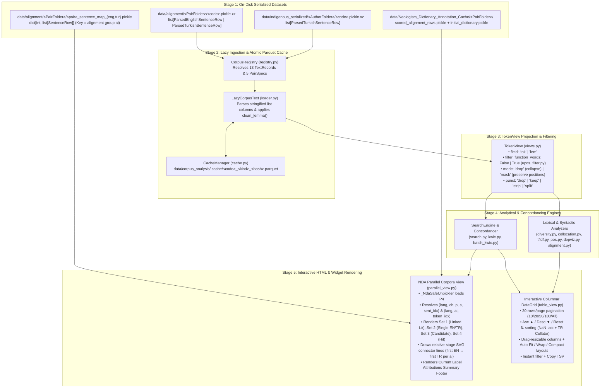

# Architecture & End-to-End Data Flow (`corpus_analysis`)

This document specifies the internal architecture of `corpus_toolkit` and traces the exact data flow from raw serialized NLP/alignment pickles and Neologism Dictionary Annotation (NDA) caches into the analytical engines and interactive notebook visualizations.

---

## 1. End-to-End Data Pipeline Diagram

---

## 2. Stage-by-Stage Data Flow Specification

### Stage 1 $\to$ Stage 2: Raw Pickles to Compact Parquet Tables (`loader.py` & `cache.py`)
1. **Source Schemas**:
   - Each `.pickle.xz` file contains a list of `ParsedEnglishSentenceRow` or `ParsedTurkishSentenceRow` objects with attributes:
     - `ch_no` (`int`), `p_no` (`int`), `s_no` (`int`), `sentence_str` (`str`)
     - Stringified Python lists: `word_list`, `lemma_list`, `pos_list`, `morph_list`, `dependency_list`, `ner_list`.
2. **Normalization & Turkish Lemma Apostrophe Remediation (`LazyCorpusText._build_tables`)**:
   - Stringified list columns are safely parsed into Python lists.
   - For Turkish texts (`record.language == "tr"`), every lemma is normalized through `textutil.clean_lemma()`, stripping inflectional suffixes after any apostrophe variant (`'`, `’`, `‘`, `` ` ``, `´`, `ʼ`, `ʻ`) while preserving hyphenated stems (`bilim-kurgu'nun` $\to$ `bilim-kurgu`).
   - Each token is classified by `upos_filter.token_class(pos, morph, lang)` into `fcl`:
     - `0`: Content word (`NOUN, VERB, ADJ, ADV, PROPN, NUM`)
     - `1`: Function word (`DET, PRON, ADP, AUX, CCONJ, SCONJ, PART, INTJ`, or Turkish morphological head `Postp, Conj, Det, Pron, Ques, Interj`)
     - `2`: Punctuation (`PUNCT, SYM` or non-alphanumeric surface string).
3. **Two Materialized DataFrames per Text**:
   - **`text.tokens`**: Columns `sid` (`int32`), `ti` (`int16`, 0-based sentence-local token index), `tok` (`category`), `lem` (`category`), `pos` (`category`), `morph` (`category`), `head` (`int16`), `rel` (`category`), `ner` (`category`), `fcl` (`int8`).
   - **`text.sentences`**: Columns `sid` (`int32`), `ch_no` (`int16`), `p_no` (`int16`), `s_no` (`int32`), `text` (`str`), `n_tokens` (`int16`), `n_content` (`int16`).

---

### Stage 3: `TokenView` Projection (`views.py`)
`TokenView(text, field="lem", filter_function_words=False, mode="drop", punct="drop")` constructs a lightweight vectorized projection over `text.tokens`:
- **`forms`**: `np.ndarray` of strings (`tok` or `lem`, transformed by `punct` regime `drop | keep | strip | split`).
- **`sids`**: `np.ndarray` of sentence IDs (`sid`) for enforcing `sentence_clamped=True` window boundaries.
- **`trows`**: `np.ndarray` mapping every projected item back to its exact row in `text.tokens` (critical when `punct='split'` decomposes `robot-bilim` into two sub-tokens that both point to the original token coordinate `ch · p · s · tok`).
- **`elig`**: Boolean mask indicating whether a position is eligible to match as a search node or collocate (`False` for masked function words when `filter_function_words=True, mode='mask'`).

---

### Stage 5A: NDA-Aligned Parallel Corpora Data Flow (`parallel_view.py`)
When rendering side-by-side English $\leftrightarrow$ Turkish aligned groups (`show_parallel(loader, pair_code, alignment_ids, ...)` or `render.show(conc, "parallel", loader=loader)`):

1. **Sentence Map Resolution (`AlignmentIndex`)**:
   - Loads `<pair>_sentence_map_eng.pickle` and `<pair>_sentence_map_tur.pickle` (keyed by integer alignment group `ai`).
   - Each alignment group `ai` contains $N_{\text{en}} \ge 0$ English sentences and $N_{\text{tr}} \ge 0$ Turkish sentences, defining the alignment shape (`1:1`, `1:N` split, `N:1` merge, `N:M` complex, `1:0` omission, `0:1` addition).
2. **NDA Cache Hydration (`NdaOverlay.load` via `_NdaSafeUnpickler`)**:
   - Reads `data/Neologism_Dictionary_Annotation_Cache/<PairFolder>/scored_alignment_rows.pickle` and `initial_dictionary.pickle`.
   - **Coordinate Indexing**:
     - In `scripts/Neologism_Dictionary_Annotation`, `CorpusModel.ingest()` assigns each `Token` both an alignment-row-wide `token_idx` (`0..M-1` across all sentences in `ai`) and a sentence-local `sent_idx` (`0..K-1` within `(ch_no, p_no, s_no)`).
     - `NdaOverlay` indexes annotations by both `(lang, ch_no, p_no, s_no, sent_idx)` (reconstructing `sent_idx` from sentence grouping when `sent_idx == -1`) and `(lang, ai, token_idx)`.
   - **Disjoint Set Extraction**:
     - **Set 1 (`Linked Bilingual Pairs`)**: `DictionaryEntry` objects where `link_type in ('manual', 'auto')` and both `eng_tokens` and `tur_tokens` are non-empty. Assigned sequential link IDs `L1, L2, ...`. Within each alignment row `ai`, the earliest English token and earliest Turkish token of `L#` receive `data-link-first="L#"`.
     - **Set 2 (`Unlinked Single-Language Irrealia`)**: `DictionaryEntry` objects with `link_type in ('single_eng', 'single_tur')` or unlinked `IRREALIA` (`SCIFI_*`) tags on `AlignmentRow` tokens. Styled with `.nda-single-eng` (teal) and `.nda-single-tur` (rose).
     - **Set 3 (`Neologism Candidates`)**: Tokens in `scored_alignment_rows.pickle` with `is_neologism_candidate == True` or `neologism_score > 0`. Styled with `.nda-candidate` (amber) and `neologism_score` tooltip.
     - **Set 4 (`Search Query Hits`)**: Matched via sentence-local `(lang, ch_no, p_no, s_no, ti)` or case-folded token/lemma fallback. Styled with `.hit` (crimson outline).
   - **Layer Ordering**:
     - Top Layer: `IRREALIA` (`SCIFI_*`) spans ordered by $n$-gram length descending.
     - Layer 0: `REALIA` / Named Entity Recognition (`NER` tags `B-*`, `I-*`) rendered as a subtle bottom bar/badge without overriding top-layer Irrealia colors.
3. **HTML + Relative-Stage SVG Rendering**:
   - Renders side-by-side English and Turkish columns inside `
` containing `<table class="par-grid">` and `<svg class="nda-link-svg">`.
   - Client-side JS queries `[data-link-first="L#"][data-lang="en"]` and `[data-link-first="L#"][data-lang="tr"]` within each `ai` block, computes coordinates relative to `nda-stage-{uid}`, and draws stepped SVG paths with arrowheads (`dropAmount = 4 + (k % 4) * 5`).
   - Appends a **Current Label Attributions (`.nda-summary-footer`)** row summarizing all Linked Bilingual Pairs (`L#`), Unlinked Irrealia/Candidates, and sentence expansion ratios for that alignment group.

---

### Stage 5B: Interactive Columnar DataGrid Data Flow (`table_view.py`)
1. **Input**: Any `pd.DataFrame`, `ConcordanceResult`, `SearchResult`, or `BatchKwicResult` (capped at `max_rows=2000` with a truncation notice if exceeded).
2. **Column Type Inference**:
   - Inspects each column dtype and values to tag `data-col-type="num"` (for `int`, `float`, `%`) or `data-col-type="str"` (for text/categorical columns).
   - Stores raw numeric sort keys in `data-sort-val` attributes on `<td>` elements so formatted numbers (e.g., `1,234.50` or `NaN`) sort accurately.
3. **Client-Side Interactive State (`root._ctState`)**:
   - Maintains `{page: 1, pageSize: 20, sortCol: -1, sortDir: 0, filterText: "", layoutMode: "auto"}` directly on the container DOM element (`#ct-tbl-{uid}`).
   - Supports instant ascending (`▲`), descending (`▼`), and reset (`⇅`) sorting, `10 / 20 / 50 / 100 / All` pagination, mouse-drag column width resizing via `.ct-col-resizer` handles, layout presets (`Auto-Fit`, `Wrap Text`, `Compact`), substring search filtering, and one-click TSV clipboard export.
